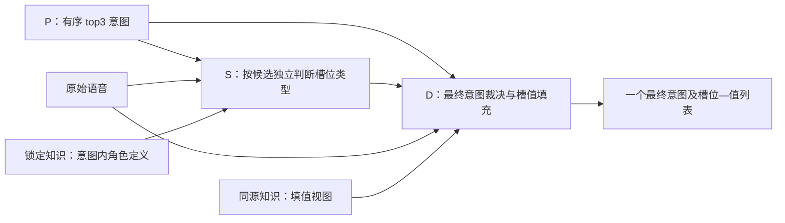

# S 类型识别与 D 最终填值：职责审查与调整方案

## 结论与边界

按最新约束：P 给出 top3 意图；S 对每个候选意图独立识别语音中表达的槽位类型；D 接收原始语音、top3 意图、逐意图 S 结果与锁定知识，选定最终意图并填槽位值。“确定性的意图＋槽位＋槽位值”属于 D 的最终输出。

设原始语音为 x，候选意图为 i，业务允许类型为 L(i)，则 S 输出 T(i)⊆L(i)。L(i) 由知识库确定，T(i) 由当前语音确定；合法不等于必填。三个 T(i) 分开保存，不取并集。S 空集合不能作为否定该意图的理由。

S 不输出值、转写、字符跨度、实体次数、解释或最终意图。类型有依据但值未知，仍可确认类型；值等于类型名称也应保留。类型识别仍需要理解语义角色，不能把不输出值理解为不理解语音。D 的确定性指单一裁决与稳定协议，不意味着从缺失信息中制造答案。



关键反证：类型集合是对语音的有损压缩。同样的意图和类型集合可以对应完全不同的姓名、地点、时间；因此 D 若只收到 P/S 标签而没有原语音，无法完成可靠填值。S 分支也不是三个最终答案，候选意图不能强迫模型把语音解释成该业务。

## 实际工程核验：协议已拆开，语义约束仍有缺口

前次静态审计覆盖 signed-relevance 冻结输入全部 1635 分支；本次复核类型任务、语义运行器、旧交接代码与最新规范化实现及回放证据。没有修改运行包或新发模型请求。

| 核验项 | 事实 | 处理判断 |
|---|---|---|
| 单候选类型任务 | 1635/1635 请求只有一个候选，schema 只有 candidate_id、slot_types、unresolved_types | 复用现有执行器，不再重写任务框架 |
| 示例答案 | 3161 次示例输出均为类型协议；按实体 type 投影，不按 filler 过滤 | 保持有类型无值、值等于类型名的契约 |
| 模型 | Qwen3-Omni-30B-A3B-Instruct，短结构输出预算 512 | 保持直接类型识别基线 |
| 知识内容 | 401 个意图—知识卡组合中，存在跨范围指令、未裁定争议与缺少意图角色定义 | 优先治理语义供给，不能仅靠 schema 限制 |
| 解析 | 冻结 parse_types 拒绝同列表重复类型；可选 after rail 已完成固定镜像回放 | 4905 条保存响应、26 项契约检查通过；新实验是否接入须按其配置核实 |
| D 接入 | 新音频桥接已由保存响应编译 545 条输入、1635 个独立分支；旧 consumer 仍是文本路径 | 编译通过不是端到端成功；固定运行环境与真实 D 效果仍待验证 |

可复查证据：本地 `CURRENT-CONTRACT-AUDIT.json`，以及 `task.py`、`handoff.py`、语义视图 `prepare.py/runtime.py`、选择器 `input/role_adapter.py`。静态核验不代表语义正确率或实时 NPU 状态。

### 当前卡片中的具体问题

- `play_music` 的 artist_name 卡包含“otherwise person”，但该意图的合法类型不含 person。全部请求中的 4 个不同意图—卡组合存在这句越出合法范围的分支指令。
- 9 个意图—卡组合包含“mom is relation, not person”，但当前合法类型不含 relation。引用范围外概念未必错误，直接指派范围外答案则需要改为当前意图内的存在性/区分描述；不能自动将其映射回 person。
- `news_query` 的 news_topic 卡既允许人物角色独立表达，又写着“the split is not fixed”。共存不是矛盾，但未裁定的标注政策没有给出可执行边界。共 4 个意图—卡组合命中这类说明。
- 40 个意图—卡组合仍出现“Intent-specific role assertion withheld pending source review”。保留合法类型是正确的，但通用实体定义无法自动补齐它在当前业务中的角色。
- `email_sendemail` 的 artist_name 卡同时描述“邮件收件人”与来自音乐任务的通用线索；“词类像艺术家”与“本句承担收件人角色”的关系必须由锁定业务定义裁定，不能让教师凭常识决定。

上述数量是各项命中的不同意图—卡组合，可重叠；不是错误样本数，也不是已证明的错误因果。逐项核来源后再修订，不能用字符串命中直接删除知识或评价样本。

## 知识构建：同源双视图，以角色区分为核心

维持同一套锁定业务知识，编译 S/D 两种视图，避免各自维护后逐渐冲突。

| 内容 | S 视图 | D 视图 |
|---|---|---|
| 意图与合法槽位 | 意图条件及完整合法类型 | 相同版本与映射 |
| 类型语义 | 当前意图中的角色、存在依据、易混差异、共存条件 | 复用相同角色定义 |
| 值的恢复 | 不要求输出具体值 | 实体恢复、同类型多值、格式与归一化 |
| 示例 | 原始语义上下文＋类型集合 | 按填值需要提供有来源的值标注 |
| 来源/争议 | 程序侧可追溯；模型看到已审定规则 | 使用相同裁定及版本 |

S 卡需要回答：本意图下这个类型指什么角色、语音中什么表达支持它、与邻近类型如何区分、何时可以共存。只针对真实易混关系构建共同区分卡，不做槽位笛卡尔积。既不能靠关键词强制选择，也不能靠缺少具体名字否定已经表达的角色。

封闭词典、开放实体、数值/时间的划分更适合 D 的填值工具组织；S 统一判断角色是否存在，例如区分日期与钟点，不做日期换算。移走大小写、值序列化和实体计数要求时，要保留真正影响角色识别的语义。

构建阶段先处理：跨意图通用规则覆盖局部定义、过强互斥、缺失存在判据、卡例冲突、未审定争议。示例没有标某类型不自动等于反例。错误样本依既定证据标准裁定并版本化排除；不能因模型答错或知识有疑点就删除评价样本。测试样本不进入教师策略选择与知识修订依据。

具体编译规则：用 `(intent_id, slot_type)` 绑定业务定义，共享槽位说明只作为通用背景。局部定义与全局模板矛盾时，先核来源再生成一份一致的模型视图，不能把两段矛盾内容一并塞给模型并要求“自行优先”。来源编号、争议和裁定理由保存在程序审计侧。S 卡保留存在依据、易混角色差异与允许共存条件；D 卡补充值格式和工具，不从 S 卡删除影响角色判断的语义。

两项候选已完成完整实验：邮件 artist_name 使用已有本地收件人定义替换音乐任务线索；news_topic 将未裁定的 split 说明移到审计侧。前者学习 Exact 283→277，后者 283→283，均未整体晋级。实际改输入目标仅分别 19、62 条，目标 Exact 分别 11→10、39→40；不能把未改输入上的波动算成知识修复收益，也不能据此否定意图内角色知识的必要性。

## 知识消费：固定范围，动态提供判别示例

before_model_call 按当前候选意图精确加载完整合法类型及角色卡。合法类型不能被向量召回阈值裁掉；全句语音向量与片段槽位定义的相似度也不能充当类型存在判据。

动态检索只负责同意图 TRAIN 示例：先提供相关锚例，再在相关性预算内补充有来源的区分或共存例。查询金标不参与选择。同一真实示例中的值词可以保留，因为它们承载角色语义；限制的是 S 的输出任务，不是抹去示例中的语义信息。

有源角色注册从 calendar/music/cooking 的少数关系扩展了邮件 person/relation、外卖 business_name/business_type，但仍不能把注册表未覆盖理解成业务没有该角色。早期有界对照只改变 11/1635 分支、其中 6 条学习正确意图输入；后续扩展相对 signed 父也只改变 13 条学习输入。局部覆盖不能冒充全 S 任务优化。

按四层诊断供给：合法源池是否存在 → 检索/过滤是否保留 → 少量示例预算是否挤出 → 实际供给后模型是否仍混淆。类型覆盖多不等于区分度高；相似度高也不保证覆盖关键差异。只有明确缺少某种证据时才补对应知识，避免不断添加无关上下文。

few-shot 的选择目标应是帮助区分当前意图内的角色：相关锚例承担语义贴近，有源对照例说明相邻角色差异，共存例防止错误互斥。三者不要求每次各塞一个，更不枚举槽位组合；沿用可配置预算，在实际存在混淆的类别补充所缺证据。只改变“被选示例”，却没有改变目标错例的输入，不算已经检验该修复机制。

### 完整错误分析给出的修复分流

角色注册扩展版的学习 476 中有 101 个漏提类型事件：51 个已经供给正例与卡片，44 个在相关候选池内但被两例预算挤出，4 个落在 top32 外，2 个落在相关性差值过滤外。合法 TRAIN 中均有正标来源。这是供给阶段分类，不是已经证明的错误原因；原语音还可能存在识别困难。

- **源定义不清或冲突**：修 `(intent, slot_type)` 角色卡、共同区分和共存说明；不能通过增加相似例掩盖规则矛盾。
- **源存在但没被消费**：保持相关锚例，选择能补充当前角色差异的有源示例；允许配置化的条件第三例，不把两例预算当业务原则，也不无条件加例。
- **证据已供给仍漏提或混淆**：检查模型实际看到的角色表达、卡例一致性及音频理解；不要继续声称缺知识。改提示词、组织方式与对照例后按类别验证。
- **标注争议**：回到原业务定义和原始证据裁定，不能把所有不符金标的输出自动视为模型能力问题，也不能根据模型失败自动剔除样本。

同一扩展版的 148 个多提事件中，74 个对应类型也已有正例与卡。这提醒我们：正例证明某类型如何使用，不证明它在当前语音中存在。示例选择应改善角色判别，而非最大化展示类型数。

## 输入输出与 rails：三路独立，D 持有原始证据

当前兼容模型协议继续使用：

```json
{"candidate_id":"calendar_set","slot_types":["person","relation"],"unresolved_types":[]}
```

candidate_id 是输入候选的回显，不让模型重选意图。slot_types 是去重集合；两个人名仍只有一个 person 类型。unresolved_types 仅表示类型是否存在或角色归属未决，不表示值未知，不是未选类型的补集，也不算已确认召回。现有语义版本中未决使用很少，删除该字段不是主要精度修复；后续简化应独立版本化。

before rail：绑定原始音频与单候选，加载同源合法卡片、相关示例和固定模板，检查来源与标签映射。不要额外塞 ASR、槽值工具或当前样本金标。

after rail：解析、校验候选与合法类型、在单列表内安全去重并留痕、稳定排序、装配 D 输入。合法但预测错误是模型错误，不应按协议失败弃答。非法标签、错候选或确认/未决冲突不能靠猜测修补。

交接 D 至少保留：原始音频引用及内容可访问性；P 有序 top3；逐意图 S 类型与未决列表；成功/空结果/失败状态；一致的知识版本与可加载填值卡。协议失败不得变成空集合，也不能因此丢弃整条样本。其他正常分支继续保留，失败分支携带状态进入受控恢复流程。

D 选择一个最终意图，输出该意图的槽位—槽位值列表。同类型多值在 D 表达；值确实未知时遵守明确缺值协议。D 必须重新利用语音证据，不按 S 槽位数量选意图，不因 S 提供某类型就强行填值。

若 D 严格只能填 S 的确认类型，S 漏提构成系统上限；建议后续把 D 在选定意图合法范围内的补漏作为独立恢复能力评估，不能把 D 修正计成 S 收益。目前尚无该新交接链路端到端完成证据。

边界特别说明：S 的 `[]` 表示当前候选下没有确认类型，`null` 加失败状态表示结果不可用，二者不可互换。确认类型但填不出值时，由 D 记录缺值；不得倒推成 S 无类型。`unresolved_types` 也不能成为输出全部剩余合法标签的通道。D 对 S 的采纳、删除或补充应由程序侧记录差异，以区分 S 识别收益和 D 恢复收益。

## 提示词：先让知识一致，再调整表达和顺序

固定模板明确五件事：候选是假设；仅识别当前语音中的业务角色；合法非必填；类型有依据而值未知仍可识别；只返回类型 JSON。允许独立角色共存，示例内容不是当前语音事实。不要追加“尽量把所有类型找全”等无边界指令。

推荐可复用的模板含义：

> 对给定候选意图，依据锁定角色定义识别当前语音实际表达的合法槽位类型。候选不代表最终意图，合法类型不是必填项。依据角色区分同意图内的相近类型，角色独立表达时允许共存。无需恢复具体值，不因值未知而遗漏已表达类型。示例用于理解定义，不是当前语音证据。仅返回规定 JSON，不输出槽位值、转写、解释或最终意图。

父版本输入重复放置整段任务指令；已独立验证去重，以及“候选与知识→示例→当前语音→短输出提醒”的布局。音频置后有机制依据，但不预先宣称最优。已完成的 ACE context-1 只去重复指令；context-2 同时改变顺序、标题和尾提醒，是复合策略，不能将其结果单独归因为音频位置。

输出约束只出现一次完整定义，尾部至多短提醒；知识卡放业务定义，few-shot 放使用示范，固定模板放任务与协议。模型采用 Instruct 类型识别基线，避免用“不要输出值”掩盖仍残留的值提取任务，也不要求它在 JSON 外打印推理过程。模板中应明确：两次提及同一类型仍只输出一次；类型确认与值是否可辨认分开；未提及的合法类型不必输出。

## 对新职责划分的对抗性检查

结构具有明确依据：给定意图缩小合法类型空间，类型识别免于值的转写、格式及归一化负担，D 保留完整语音来完成最终裁决。但它不是自动带来收益，必须防住以下退化。

| 看似合理的做法 | 可能破坏的机制 | 采用的约束 |
|---|---|---|
| 所有值相关语义都从 S 删除 | 日期/钟点、人物/关系等类型差别也被删掉 | 删除填值任务，保留判定角色所需的语义上下文 |
| 候选意图已知，所以合法槽位都输出 | 把候选假设误当语音证据 | 合法集合完整加载，输出集合由原语音支持 |
| 三个分支取并集再交 D | 丢失意图—类型条件关系，引入跨意图污染 | 三分支独立保存，候选与类型严格绑定 |
| 正例覆盖越多越好 | 示例内容被套用到当前语音，增加混淆提取 | 相关性、角色差异、共存证据和冗余共同约束选例 |
| D 只能接受 S 确认类型 | S 漏提固化为端到端上限 | 严格模式用于诊断，恢复模式允许在最终意图合法范围内纠正并单独记账 |
| 把其他两个候选分支当全负样本 | 没有条件化标注也惩罚可能合理的角色识别 | S 主分数只计正确意图分支，三分支贡献由 D 端验证 |

“类型集合不是充分填值信息”还意味着，D 不能仅靠类型列表恢复多个人名、时间和实体次数。原语音必须保留；S 不负责实体计数，D 可以输出同类型的多个有证据实体。确定性应落实为一个最终意图和稳定结构，不应强迫模型对不可辨认的值编造答案。

## 新 D 桥接的实际状态与必要调整

当前新桥接已完成 CPU 编译 545 条输入，复核 1635 条保存 S 响应；129 个列表顺序差异经类型集合比较后一致。三条分支对应的原知识快照缺少 `play_game/game_type` 卡，已明确记录来源缺口，未编造补卡。需要区分“标签合法”与“解释知识齐全”，后续应从审定来源补足说明，不能仅为通过检查删除合法类型。

桥接已写明原音频、P 有序 top3、独立 S 状态、同源知识和 D 结构输出，并区分严格/恢复模式。首轮固定镜像检查在实际框架导入时失败，原因是 Python 入口缺少 openjiuwen；改用同镜像已有依赖的入口后，完整545输入、1090请求变体、28项契约和5项真实NativeRoleNode检查通过，容器exit 0，主线程核对实际测试源码摘要一致。成功检查38.49秒，失败尝试34.60秒分别保留，无新模型调用。该失败属于运行环境接入，不能当作模型失败。D recovery完整545真实基线已在前驱S实验终态后自动接续，主线程直接核实远端容器运行；固定预算最大总上界53,349，输出1,024，仍没有完整D端到端精度，不声称已完成效果验证。

后续最小验收聚焦实际职责：三分支绑定、空与失败不同、类型存在但值未知、同类型多值、值等于类型名、D 补漏/删除可追溯，以及原生 before/after 调用链。保持既有运行器和配置入口，不重建框架。

## 最新结果对方案的约束

以下都是已完成完整 S545×3 实验中的学习 476、正确意图分支；不同父版本不能串成累计收益。非空样本为 341。

| 改动与直接父 | 集合 Exact | FP / FN | 非空完整供给 |
|---|---:|---:|---:|
| 原语义视图 → 内部完整性检查 | 283→277 | 144/101→163/99 | 247→250 |
| rank32 → fallback 相关性优先 | 272→283 | 163/92→150/99 | 255→249 |
| signed-relevance → 示例内正片段标记 | 283→273 | 150/99→136/125 | 249→230 |
| signed-relevance → 有界角色对照 | 283→283 | 150/99→146/106 | 249→243 |

正片段标记的 387 条实际改输入学习样本中 Exact 220→210（20 修复、30 回退）。它可能改变注意分配，部分标注也可能被误当完整边界；目前这是待核机制，不是已证明根因。不能将“卡片合理”推导成“任意展示增强都必然有益”。

有界角色对照实际只改 6 条学习输入，Exact 3→2；470 条未改输入仍有 17 修复、16 回退。单次总体持平不能证明策略有效或无效，更不能证明少量改动能解决整个 S 任务。这些候选未整体晋级。

最新已完成的两项上下文候选，统一在学习 476、正确意图分支比较：

| 配置 | 集合 Exact | TP / FP / FN | 非空完整供给 / 341 | 空 gold 误提 / 135 |
|---|---:|---:|---:|---:|
| signed-relevance 父 | 283/476 | 453 / 150 / 99 | 249 | 55 |
| context-1：去重复指令 | 288/476 | 446 / 131 / 106 | 243 | 42 |
| context-2：布局复合策略，strict | 287/476 | 464 / 155 / 88 | 261 | 69 |
| context-2：同一响应，集合规范化 | 289/476 | 467 / 155 / 85 | 263 | 69 |

去重复提高 Exact、减少多提，却增加漏提；布局提高完整供给，却增加空样本多提。说明不能只用 Exact 选择供给 D 的方案。规范化只恢复合法重复数组：三臂共 4905 条回放中恢复 3 条，原合法 4902 条语义集合不变；学习两条恢复正确，报告分区一条仍预测错误。26 项契约检查和固定 CPU 回放均通过，新增模型调用为 0。这是接口修复后的重算，不是模型新增收益；strict 历史记录保留。

以上数据来自保存的完整结果，不是本轮实时负载。角色对照完整运行 545/545、1635/1635 有效，4 卡单实例并发 64，810.78 秒、吞吐折算 1.488 秒/完整样本；该折算不是单分支延迟。

## 评价与实施优先级

固定 S545×3，476 用于学习、69 仅报告；正确意图来自锁定 P 的 top3。其余两分支没有条件化金标，不能直接当全负样本。该 S 指标以 P 正确召回为前提，后续系统报告仍须展示 P 失败造成的覆盖缺口。

对正确意图分支 gold 类型集合 G、预测 T：

- Exact = mean[有效且 T=G]；CountAcc = mean[有效且 |T|=|G|]，数量仅为诊断。
- TP=Σ|T∩G|，FP=Σ|T−G|，FN=Σ|G−T|；micro F1=2TP/(2TP+FP+FN)。无有效输出的样本仍留在分母，gold 类型计入漏提。
- CompleteRecall = mean[有效且 G⊆T | G≠∅]，并列空 gold 误提率、各意图/类型及混淆对表现。
- 有类型无值、值等于类型名、共存、多次提及分别检验；无真实切片覆盖时明示缺口，不伪造切片成绩。
- D 单独统计最终意图、填值、恢复/误改；再报告端到端结果。不得用输出全部合法类型虚增完整供给。

对 S 的优化选择保留向量目标 `(Exact, CompleteRecall, FP, FN, 空集误提率)`；当前缺少 D 端真实损失证据，不随意设置加权和把不同错误掩盖掉。优先选择在同一学习集上减少漏提且不增加混淆的策略；有收益交换的候选保留并分别评估，不凭几个样本定生死。“槽位数量相同”不应优先于“类型正确”：一个漏提加一个多提可使数量正确，却完全没有修复业务结果。

结构选择依据任务机制；具体实现以类别覆盖、配对结果与可追溯证据验证。少量波动不否定角色知识结构，也不能跳过对错误规则和误导示例的检验。

优先顺序：

1. **知识语义对齐**：修审定的跨意图分支指令、局部角色缺口和卡例冲突；保留共同区分及共存知识。争议留程序侧，供给经来源审定的适用规则。
2. **同意图消费对齐**：按上述四层定位失败，复用现有注册表和示例选择接口；目标类别未被策略触及时，不浪费 NPU 把它算作目标修复实验。
3. **最小交接闭环**：在已有 rails 中实现必要去重、状态区分和真实 D 消费；用契约测试保护分支绑定、空/失败、类型保留，不重建执行框架。
4. **提示词与布局优化**：在相同知识基线下使用现有配置入口；教师接收类别根因、代表轨迹、来源冲突与策略反馈，ACE/TF-GRPO 保持各自模板，优化类级策略。
5. **锁定后接 D**：S 独立结果明确后开展 D 填值与最终意图优化，严格链路和恢复链路分开核算。CPU 准备/分析与已就绪 NPU 实验异步。

本轮交付为工程审查与具体调整方案，引用已有全 1635 输入静态核验；没有修改冻结运行包或宣称 D 接入已完成。

本次复审补核类型任务与语义配置、示例选择器、错误供给分类、最新卡片/门控完整比较及新 D 桥接源码与编译记录。结论已更新，运行候选不在本次文档审查中修改；D 编译完成与 D 效果验证明确分开。
