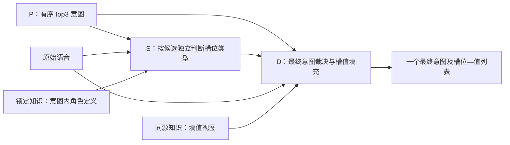

# S 类型识别与 D 最终填值：职责审查与调整方案

## 最新数据规模约束：5000探索＋1000独立dev

用户已明确确认：至少5000条TFRL探索样本、至少1000条独立dev样本，两者不重叠；正确query不发送远程教师。此要求覆盖下文旧545/476/69作为正式优化验证的安排，旧集仅保留历史回归与先导结果。此前283→290等结果不能据此宣称稳定收益。

主实际盘点TRAIN11514语句、11436源分组、50628录音，60个规范意图（原始intent字段有91种字符串）；已有TRAIN10000准备记录，FoldA/B各1080来自train，已有DEV1000来自官方devel。以上是原始来源数量，尚非质量清洗和冻结P正确召回后的最终可用量。优先复用稳定来源，核质量排除/录音别名/知识源重叠；有效dev不足1000则从同源确定性补齐。历史dev暴露须披露，不称新盲集。

教师只取探索集当前错例、未决和失败轨迹，按类别代表采样；正确query保留本地回归，不作为教师反证逐例发送。可发送必要业务定义与匿名聚合反馈，dev逐例不进入策略优化。P失败保留端到端分母，S条件优化从P正确供给中补足5000；禁止以重复录音凑独立样本数。

三个现有CLI分别负责：A稳定大集manifest和P轨迹/来源；B教师失败采样接口；D配置化大规模可恢复执行与收尾。D第一教师候选已真实启动，第二545尚未dispatch，批准已撤销以落实新规模；在途请求正常收终态，不重发。新的小集教师请求与模型实验停止准入，已有API结果只保留待大集验证。

主已独立复算A学习283→290、FP150→135/FN99保持；新增正例支持的6个FN事件恢复3个、原正确失去示例支持的6个事件丢失2个。这些是机制线索而非独立因果证明。后续完整样本配对评估，按源分组估计置信区间，记录反复策略选择次数；样本量5000/1000本身不保证统计显著性。

### 当前有效规模与单分支执行（原位更新）

稳定探索来源9934条，已验证P响应7541条，其中6682条正确意图进入top3，859条未命中，2393条待完成。有效样本已超过5000要求，并覆盖全部60个规范意图；正确意图原始位置为第1位5906条、第2位534条、第3位242条。这是P准入结果，正式大规模S指标尚未产生。

5000指筛选后有效样本，不是原始P调用数。S开发每条仅运行真实P top3中的金标意图分支，保留其原位置，另外两条不运行、不评分。输入不提供金标槽位类型或值，S只输出槽位类型，D负责值。筛选后P@3=100%是S准入条件；原池未命中独立报告。

单分支接口已通过固定镜像验证。知识卡来源投影已修复首32条受阻样本，并完成11948个探索与dev身份的来源普查；原渲染器、完整类型库存、知识快照和handoff检查通过。修复移除无合规来源的正文，替换为真实TRAIN观察，不能声称语义等价或精度提升。S正在编译首4021条输入，最终固定集合将用不重叠补集满足至少5000；后续比较使用同一集合，不按S表现选样本。

独立dev候选池2014条音频编码已经全部完成。两片首次因容器逻辑设备编号错误退出，修复后只补缺失片，首672条保留。原Instruct服务已恢复并现场确认模型API可用；下一步按实际ID与向量绑定编译dev P，要求最终至少1000条P命中，当前尚无dev P结果。

两个探索P后继已由终态事件队列自动启动，现场分别完成290/1200、629/1193，均确认运行。每实例4卡、并发64。最近完整1200条批次耗时456.70秒，摊销0.381秒/新请求、6200146 tokens；这是吞吐折算，不是单请求延迟。第三实例已恢复，等待已准备输入接续；不宣称三个实例持续满载或AI Core持续超过80%。CPU的S编译、dev输入准备与两路P推理异步进行。

正确探索轨迹留在本地回归，仅探索集S错例送教师，dev逐例不进入教师。本轮没有新教师调用，也没有正式大规模S收益结论。

### 历史首批终态（非当前累计规模）

首批P已完成768/768（753新请求＋15同配置响应复用），输出协议有效768条，其中金标意图进入top3共688条，另80条不进入S开发集合。主已独立核688条准入清单唯一且全部top3命中。当时S准入规模为688/5000，尚缺4312条，不能将768称为目标数据集。继续采集并累积真实P命中后冻结完整集合。

三路新请求各耗时92.95/93.34/91.07秒，摊销0.373/0.372/0.360秒每条P请求；共3695292新tokens、约0.308卡时。首批已结束，以上不代表后继任务已经满载。原始首批P@3为688/768；筛选后的S准入集合P@3为688/688，二者须分开报告。当时单正确分支S代码尚在调整；当前实现情况以上方原位更新为准。

### 最新锁定：5000条P有效样本，S只优化正确意图分支

5000条指经过冻结Instruct P真实推理后、金标意图位于top3中的至少5000条独立样本。首批768仅为P采集分片；持续扩大稳定来源的采集直到满足有效数量。入选S集合P@3=100%是明确的准入条件，原池P未命中另外报告，不能将条件筛选后的100%宣称为全域P准确率。

S开发态每条只运行、评价金标意图对应的真实P分支，不运行另外两个非金标候选；因此5000条对应5000个S请求，执行接口已按单正确分支调整。输入保留原音频、该意图的完整合法知识和有源示例，保留原P候选位置及响应证据；不注入金标槽位类型或值。S继续只输出槽位类型，D填槽位值。指标看正确意图条件下的类型集合Exact、数量一致、TP/FP/FN及有类型但无值等类别。

独立dev保持来源隔离，同样只评正确意图分支；明确报告P准入前后数量，若有效规模不足1000，从官方devel稳定序列补齐并保留原失败台账。正确探索轨迹本地回归，只有探索错例进入教师。单分支接口已完成实施和固定镜像验证；正式规模仍按顶部当前台账报告。

### 首批大规模 P 采集已实际启动

首批768条探索查询中，15条复用完整同配置Instruct响应，753条新请求分为249/251/253三片。三个TP4实例、共12卡，客户端每实例并发64，输出128 tokens，Q15/D5与top3排序索引协议保持。主已独立核实三路容器在运行且产生真实响应：现场快照分别完成81/249、49/251、12/253，三路启动协议检查均8/8有效。该快照不是终态，当前尚无完整批次吞吐或可靠剩余时间估计，也不能据此声称AI Core持续超过80%。

首轮因缺少serving会话目录挂载而在发请求前退出；三路均核实0请求intent、0响应，补齐只读挂载后接续原科学输入，保留失败证据。没有重发未知请求。固定镜像检查已通过全部753新请求，最大输入输出预算上界分别27297/26189/26724。

完整探索池仍为9934；6341条可使用现有来源合规卡片，3593条需先清洗卡片来源，其中3583条涉及三张卡共同引用的已确认错误标注TRAIN来源。待处理查询保留总分母，不因卡片问题从数据集删除。三个CLI分别并行准备后续探索与dev、运行及归档、完成有源卡片投影。正式5000条P有效S探索与1000条dev尚未完成，当前无新教师请求或稳定系统收益结论。

### 教师只消费当前探索错例

正确探索轨迹全部留在本地回归，不发送远程教师。S当前任务只判槽位类型；合法类型集合正确时，不因缺少槽位值或额外未决项转发教师。每轮只按错误类别抽取必要失败代表，提供真实失败输入、知识卡、示例、原输出与评分反馈，要求教师提出类别级根因与可执行策略。策略应用后，固定完整集合同时统计修复和退化；修好的样本退出下一轮教师输入，但继续本地回归。dev逐例始终不进入教师输入。

上述分流及材料边界已经实现并通过回放。正式大规模评分尚未生成，当前没有因此新增教师调用。数据编译与运行由两个既有CLI协同推进；新Instruct P首批尚无启动回执，编译中的模板兼容问题由原owner处理，不能把服务在线称为实验满载。

### P模型身份复核与大集接口进展

主核历史7094条P采集的配置与实际请求，以及此前414条命中所属fit来源，均为Qwen3-Omni Thinking模型关闭thinking；不能算作当前Instruct基线结果。A已改写manifest，当前已核来源的Instruct可复用数为0、9934条标待绑定/采集，历史Thinking轨迹独立保留。随后主定位到真实Instruct FoldA1075缓存，与新探索池精确sample_id重叠238条，其中历史top3正确228条；这些仍须核完整请求、知识来源过滤和原响应，尚未计入可复用数。已知历史素材复用，模型回答按完整配置核定，不盲重发未知请求。此前“414可复用”的表述由本节纠正。

规范意图为scenario+action，共60类。原始intent字段有91种字符串，其中162条使用query/music等局部形式；91不是业务类别数，此前原始盘点口径已纠正。探索候选涵盖60类，现dev1000未含audio_volume_other，少数类别需单列覆盖，不能由总分推断所有类别表现。

S大集执行接口已固定镜像验证7真实样本×3分支，三片9/6/6分支，分片并集完整且交集0；主独立重算分片一致。原持久日志验证已知响应复用、未知请求拒绝重发、0 HTTP。这里只证明接口，不冒充5000规模运行。

教师接口进一步补齐：只展开所选失败的原请求、实际卡片/示例、提示词与原模型输出，正文按hash去重；教师不需要访问本地路径。主实际检查真实失败引用边界回放通过，12失败含24条原TRAIN fewshot、81个唯一文本体和对应raw输出；正确/dev当前query不导出。另已通过空示例、空知识供给和已知协议失败材料用例，缺供给本身可被教师分析，不伪造示例、不把合法空列表当材料缺失。

执行原owner完成交付退出，主核进程消失后已用一个CLI接续，仍最多三工人。A独占科学输入编译，执行owner接READY后绑定三实例实际资源并启动，避免两方重复派发。当前仍无大集launch回执；优先完成Instruct P首批，其他分片/教师CPU接口异步。

### 大规模切换实测进展

来源准备已完成并经主独立复核：复用原TRAIN10000，剔除45个质量关联分组、21个与dev重叠分组，剩9934个独立探索候选；跨TRAIN/devel规范化文本、录音别名和旧分组传递闭包后，与dev零交叉。原dev1000保留999，因既有质量排除去1并从原devel按固定顺序补1，最终1000独立有效分组。保留FoldA/B和原545归属，以便横向对照。全部9934查询向量复用，没有新音频编码或embedding调用。

这还不是5000条S优化ready。此前414命中、50未命中、9470未匹配来自历史Thinking/OFF台账，不能用于计算当前Instruct的有效量或缺口；以本页模型身份复核为准。最终有效量须由当前Instruct的完整请求、来源和真实响应确认，不能用召回标签并集、金标或候选样本数代替P输出。

已明确下一项NPU准备为冻结P配方补采：先复用可证明同配置的已知结果，再通过现有执行器三实例分片采集真实缺口，接续S大集。数据CPU准备不占推理资源。此时尚无大集NPU launch回执，不能声称已满载或已开始5000推理。

错误采样器已由原owner修正且主实际执行检查通过：正确类型集合即使有额外未决项也不发教师；dev不发；使用源分组映射隔离；按配置跨轮覆盖错误类，25类在3轮预算12下全部覆盖；预算可配20；缺query或轨迹标待材料；禁止嵌套正确/dev包。历史545回放仅验证接口，不作新的研究样本。模板展开引用后的内容边界与正式大集评分绑定仍待完成。

D在途第一候选已完整545有效，250.21秒、0.4591秒/条、4卡1实例、3974216 tokens。主独立学习476复算：意图388→390、意图＋类型223→225、原始意图＋槽值119→115；类型TP443→461、FP175→202、FN109→91。S正确类型被同意图D删除27→12，但D新增FP49→62；保留更多类型与扩张混淆同时出现。小集只作先导，不晋级。第二候选未dispatch，已按新规模取消，既有CPU准备保留。

B第五次既有ACE请求正常返回：988.75秒、98724 tokens（47791输入、50933输出，其中48211 reasoning），两策略保存而不在旧545执行，0重发。D变长manifest接口已有真实7条3分片固定镜像CPU检查通过，但它不能冒充S大集ready；已要求执行owner优先P补采/S接口，D泛化不作前置。

## 历史545先导阶段记录（由上文大规模协议取代）

本次为现场状态核对和结果审查，非新增模型实验。S已是Instruct纯类型任务，D负责最终意图及槽值。固定545条、每条三个S分支；476用于策略优化，69只报告。本轮没有新的完整测试集结果。

### 已完成实验

|实验目的/调整|完成量|476学习结果|效率与资源|判断|
|---|---|---|---|---|
|A：扩大合法TRAIN示例索引，4569→5669；选择算法不变|545/545，1635/1635有效|类型Exact283→290；TP453保持、FP150→135、FN99保持|798.15秒，1.4645秒/完整样本；4卡1实例；7054822 tokens|有正向消费信号，尚未锁定稳定收益|
|B：恢复日历date原有存在性条款|545/545，1635/1635有效|相对直接父Exact286→282；实际改输入13条7→7，date TP/FN不变；相对signed283→282|795.60秒，1.4598秒/完整样本；4卡1实例；7049213 tokens|没有目标收益，不采用此候选|
|C：D参考与当前请求消息隔离|545/545有效|相对role-scope意图388保持，意图＋类型223→217，意图＋槽值119→102|246.65秒，0.4526秒/条；4卡1实例；3848208 tokens|退化，不采用|

以上秒/条是整批墙钟时间除样本数，S包含三个分支，是摊销吞吐指标，不是单条请求延迟。已完成任务剩余0。A/B来自新交付完整配对报告，本轮主已核生成终态，尚未重新独立逐条复算。

A实际改变学习输入138条：Exact67→76，13修4退；相同输入338条216→214，不把同输入变化归为策略收益。69报告集37→36，只作保留报告，不据此调参。非空完整召回249→248，说明主要收益是少混淆提取，并未系统解决漏提。

### 当前资源与实验设置

现场三个服务均在线，三个端点running=0、waiting=0；A/B上一轮已结束，C后继准备，当前没有本项目推理请求在执行。服务驻留不等于NPU有效满载，也无AI Core持续>80%的证据。

三路均Qwen3-Omni-30B-A3B-Instruct，TP4，BF16，65536上下文，服务max-num-seqs128、max-num-batched-tokens2048、显存比例0.92。实验客户端并发64；S输出512，D输出1024。128是引擎最大序列数，64是客户端请求并发，2048是调度token预算，不能统称batch size。当前命令包含多模态共享内存cache；这不等于已核实prefix cache启用或命中。

三个CLI工作进程及队列服务仍存活。B的第五次ACE请求本机在途；D教师已返回两策略，128171 tokens、689.49秒，未重发。D两候选已完成完整545固定镜像准备，最大输入输出预算58409/58061，尚未启动。第一份指令存在同类型多片段保留歧义，已通过文件交回原owner修正；第二份无源统一大小写/标点规则已经删除。

### S方案应优先改什么

1. 知识构建：同源生成S角色存在/区分/共存视图与D填值视图。保留原句语义与合法角色，移走S不承担的值格式、数值换算等指令。跨意图模板与局部角色冲突先裁定来源。
2. 知识消费：当前意图的完整合法类型直接加载；动态检索用于挑选同意图、有区分作用的原TRAIN示例。扩大合法源池已见正向信号，下一步分析实际修复类别与残留FN，不无条件扩上下文。
3. 接口：三分支独立；S保持candidate_id/slot_types/unresolved_types。类型存在但值未知仍保留；无类型与调用失败分开。after rails只做合法校验、无损去重与组装，不替模型补清单。
4. D交接：接收原语音、P top3、各S分支和同源知识。S不输出值不代表语音没有值；同类型多个实体由D保留。D纠错单独统计保留、补漏和误改，不能无限扩展合法清单。

### 后继任务及决策

当前无须用户追加业务决策。沿已授权职责推进，不重开S填值、ASR级联或全量测试调优。

CPU并行：A逐类复核新来源带来的13修4退及剩余漏提；B收原ACE请求的具体策略，编译有源person/relation区分候选；D修第一提示词矛盾并更新现有READY。原owner负责实现和完整报告，主负责审查，不重造框架。

NPU：B就绪后跑完整545×3；C两份D指令顺序跑545，第二仅依赖第一生成终态，不依赖评分；A由实际缺口生成下一项消费策略，不以重复旧试验凑负载。就绪前完成数据/知识/输入准备。按既有速度，S单臂约13–14分钟，D单臂约4–5分钟，仅为历史估算、不含尚未完成的准备时间。

当前空闲的直接原因是CPU策略准备和内容审查未提前形成可执行后继，队列进程存活并不能保证队列里有任务。需要优先收敛具体策略并提前准备下一批，而非继续泛化加固。科学验收以完整固定集和受影响类别为准；机制合理支持继续完善，单次涨跌不决定结构价值。A候选目前仍不作为已锁定基线，D端到端收益尚未稳定。

## 当前职责约束：S 类型判定，D 最终裁决与填值

本节是当前方案审查与下一步实施建议，不代表下列修改已经部署或获得新实验收益。最终的“意图＋槽位＋槽位值”属于 D；S 对 P 的三个候选分别输出类型集合，三个分支不能合并。D 还必须收到原始语音，同一个类型集合无法确定具体槽值。

### 源码核验与真正的调整对象

已核对类型任务 `task.py`、语义视图 `S-TYPE-INSTRUCTION.txt` / `TASK.json`、D `bridge.py` 和 role-scope 完整结果。当前 S 已使用 Instruct、`slot_values=false`、`ASR=false`、`tools=false`、输出预算512；schema 为 `candidate_id / slot_types / unresolved_types`。语义版提示词已明确类型存在不依赖值能否恢复，不能再把已有约束描述成待开发功能。

旧类型任务仍把完整填值知识卡作为参考，靠提示词说明忽略其中的输出要求；后继已有局部角色视图及有源修订，但不能据此认为所有卡都完成了类型化。真正优先项是检查实际运行版本中，每条供给是否只服务于当前角色判定，是否与示例一致。D 已保留原音频和三个独立分支，现有 strict/recovery 模式可以复用。

### 知识构建：按业务角色拆视图，而非按字段名列清单

同一审定知识源生成两份视图：S 使用角色定义、出现依据、近邻区分与共存条件；D 使用同源角色定义及填值规则。S 不加载大小写要求、字符格式、日期转换、值抽取步骤。删去这些指令不等于删掉有助理解类型的真实例句。

每张 S 卡应回答：当前意图中该类型表示什么；哪些语义关系说明它出现；与哪些合法近邻容易混淆；何时可同时出现；什么情况只是角色存在而值未知。例如人物是事件参与者，还是作品标题的一部分，区别依赖关系而非词形。卡片不得把开放人物类型退化为姓名词典，也不得因为某训练组合未出现就规定两类型互斥。

已有意图内区分卡应保留并完善：person/relation、artist/song、food/ingredient 等属于不同区分机制，不能统一写成关键词互斥。定义、示例相冲突时，先核实业务来源与标注，再修共同知识；教师不能凭常识创造新业务规则。审计疑点保留在程序侧，不作为模型必须遵守的知识。

### 知识消费：完整类型范围，少量有区分作用的示例

按候选意图直接加载完整合法类型范围及角色卡，不以全局语音 query 与槽位片段的相似度过滤类型。语义检索只用于同意图示例选择；优先提供相关场景、真实近邻区分和允许共存的证据，去掉重复信息。没有可靠标注的遗漏不自动构造负例。

示例答案仅投影为类型集合，原句保留；原值仍存源数据供 D 使用。选例不能读取当前 query 的真实类型，也不能先假定真实类型后按它检索。若采用模型预测辅助选例，必须作为独立的两阶段候选记录成本和选择偏差，不隐含塞入当前单次调用。

固定配置建议为：任务与候选→完整类型角色卡→共同区分卡→少量类型示例→当前语音→短输出提醒。顺序有注意力与当前证据定位的机制依据，但哪种布局更优仍须同源对照，不能认定音频末置必然提升。

### 接口与 rails：三种语义状态和一种执行状态

- 明确出现：进入 `slot_types`；即使槽值未知，或槽值等于类型名称，也不能删除。
- 明确未出现：不输出；合法类型不是必填字段。
- 存在性或角色归属不明：进入 `unresolved_types`；它不是合法清单的补集，也不是“值暂时填不出”。
- 调用或协议失败：在程序 envelope 中单列状态，不伪装成两个有效空数组。

`before_model_call` 绑定一个候选、审定知识版本、示例来源和原音频。`after_model_call` 校验候选绑定、合法类型、两集合互斥，做无损去重和稳定序列化；不得按合法清单补类型、按关键词改预测或把越界内容静默截断成成功。三分支完整保存候选身份；同一类型多次提及在 S 中只记一次，D 最终仍可输出多个实体。

D 从 top3 中选一个最终意图并填值。S 结果是优先证据，不能无证据扩成全部合法类型；若 D 根据原语音修正类型，则单独记录补漏、删除及新增混淆。建议以现有 recovery 路径承接系统恢复，以 strict 路径诊断 S 信息损失，不能通过限制 D 永不纠错掩盖 S 漏项，也不能依靠 D 每次重做任务证明 S 有用。确定性指最终一个结果及明确协议，不代表未知值可以被制造出来。

### 验证目标与改动次序

S 优化目标是条件类型集合 T 与真实集合 G 一致：主报 `mean[T=G]`、micro F1；供给侧同时报 `mean[G⊆T | G非空]`、FP/FN、空 gold 混淆率及 unresolved 比例。数量一致只是诊断，类型集合大小不等于实体数量。槽值精确度不作为 S 奖励。

固定545×3，476学习、69仅报告；正确意图分支用于有金标的 S 类型评价，另外两分支不当全负例。D 分开报告意图准确、意图＋类型联合正确、最终值准确及对 S 的修正损益。P 漏召回的端到端损失另报，不藏在条件 S 分数之外。

现有完整 D role-scope 相对 value 的476学习结果：意图正确388不变；意图＋类型217→223；原始意图＋值116→119；类型FN103→109，S正确类型被D删除23→27。它证明必须分开观察收益与误改，不能据总分小涨宣称职责拆分已经成功；本节不新增模型实验。

实施优先级：①按实际卡版本清理残留填值指令、修有源角色冲突；②完善意图内区分与共存知识；③优化同意图示例的信息增益和输入组织；④保持现有纯类型schema，在固定集锁定 S；⑤用保存三分支评估 D 是否保留 S 收益。复用现有配置、编译器、rails 与执行器，不重造基座。小规模一次涨跌用于诊断具体实现，不用于否定有机制依据的角色知识结构。

## 最新实测：参考消息隔离未改善D，不晋级

D的reference-before-current候选已完整545/545有效、unknown0；原P/S、音频、角色卡、原值示例及schema保持，变化是参考与当前请求分为两条消息，同时添加当前音频grounding指令。主独立476复算，相对role-scope：意图388保持，类型集合266→262（不含意图），意图＋类型223→217，原始意图＋槽值119→102，16修33退。类型TP443→459、FP175→197、FN109→93；值TP267→253、FP391→457、FN331→345。不采用该候选。

D恢复S漏类型30→34，但恢复对应准确槽值20→15，D新增FP49→66。这说明更多类型供给不等于完整答案改善。原25条参考值重合风险中，旧风险实体仍保留16个；风险消失可能来自值替换或错误意图，不能算正确恢复。原104条意图与类型正确但值不全对保留固定组评估，69只报告。

重点时间样本仍输出five pm且漏date；联系方式样本由home phone number改phone book，未解决问题指向。文本线索不证明声音本身内容或示例复制因果。后继继续分析角色、值跨度/格式与当前音频取值机制，不能仅追加禁令或回退到无值示例的失败配置。

实测246.65秒、0.4526秒/样本，4卡1实例TP4/c64，3,848,208 tokens，剩余0；成本仅计D。原role-scope119/476完整答案为本轮科学对照，仍未锁定系统稳定收益。没有新全测试集结果。

## 本次约束复核：保留纯类型基座，调整知识与交接语义

用户要求中的“确定性的意图＋槽位＋槽位值”按上下文归属于 **D 最终输出**。S 的交付是三个独立的“候选意图＋槽位类型集合”。本轮读取实际 `task.py`、语义版 `config/TASK.json`、D `bridge.py` 及已完成的学习集报告：当前配置已经 `slot_values=false`、`ASR=false`、`tools=false`，使用 Instruct；不是尚待把 S 从填值任务改成类型任务。以下是下一版的调整方案，未修改冻结运行包，未声称新增精度收益。

### 第一性原理与可反驳边界

给定候选意图 i，S 学习的是 **p(T | audio, i, 锁定业务知识)**，而不是输出这个意图的合法字段清单，也不是一般命名实体识别。意图约束解决“哪些类型合法”，角色定义解决“听到的信息属于哪个类型”，存在性判断解决“这个类型在本句是否出现”。三者缺一不可。

单意图输入确实能消除跨候选混填的一类原因，但不能消除同意图内 person/relation、date/time、主题/独立人物等混淆。纯类型任务有明确的减负依据，却不保证忽略词义即可完成：S 无需输出姓名、日期等具体值，仍须理解这些表达承担的业务角色。

这支持建设意图内角色区分知识；小规模一次实验无收益不能否定该结构。反过来，结构合理也不能证明某版知识写对了：来源是否一致、实际输入是否触及错类、模型是否采纳、D 是否保留收益，都要分别验证。

### 各层具体改动

| 层次 | 保留 | 优先调整与验收 |
|---|---|---|
| 知识构建 | 锁定业务定义、原 TRAIN 来源；同一知识版本 | 按 `(intent, slot_type)` 编译类型视图，包含角色、存在依据、相邻角色区别、共存条件；移走填值格式、转写和数值换算指令。不能只在模板中说“忽略卡片的填值要求”，却继续把整段旧任务交给模型。 |
| 区分卡 | 已建立的意图内共同区分关系 | 从类型词典推进到“此角色为何是 A 而非 B”；只对真实易混关系组织，不枚举笛卡尔积。人物作为主题、事件名称中的人物等边界须由审定业务来源支持，不能凭常识新增排他规则。 |
| 知识消费 | 按意图精确加载完整合法范围 | 不用全句向量与槽位片段相似度筛掉合法卡；动态检索仅选择同意图示例。选例同时考虑语义相关、角色区分、共存和冗余，不能只追求类型覆盖最多。 |
| 示例 | 原句上下文、原始类型标注及来源 | 模型看到的答案只保留类型集合；原值保存在源数据供 D 使用。示例原句里的姓名、时间不可机械删除。缺标不自动生成负例；类型存在但值缺失、值等于标签名的记录必须保留。 |
| 输入 | 原语音、单候选及同源知识 | 固定顺序候选与定义→区分卡→有源示例→当前语音→简短输出提醒；这是可检验配置，不能把旧复合布局实验的全部收益归因于音频位置。 |
| 输出 | 现有 candidate_id、slot_types、unresolved_types | 不增加值、实体次数、转写、解释或最终意图。保持已用 schema，避免为讨论方案重造协议。候选 ID 可由程序绑定校验，S 不负责重新选择。 |
| before / after rails | 现有执行器与来源绑定 | before 负责知识视图、选例和输入组装；after 负责合法性、去重、稳定排序及三分支独立交接。不能通过标签清单补齐预测，更不能把失败伪装成有效空集。 |

原冻结审计的 401 个意图—卡组合中，40 个有局部角色定义待审提示，9 个含越出当前范围的 relation 指令，4 个含越界 person 指令，4 个含未裁定的 split 说明；这些是可重叠的审计标记，不能直接当作错误因果或当前所有候选的现状。后继已经修过部分卡，下一步应以候选实际使用的知识版本逐项销项，避免重复修旧问题。

### 必须明确的三种状态

| 当前语音与角色的关系 | S 输出 | D 责任 |
|---|---|---|
| 角色没有出现 | 不输出该类型 | 不因它合法就创建空值实体 |
| 角色明确出现，具体值可能未知 | 放入 slot_types | 从原始语音恢复值；确实无法恢复时按缺值协议处理 |
| 是否出现或角色归属仍不明确 | 放入 unresolved_types | 重新结合音频、候选和知识裁决；不把未决当确认类型 |

“S 不输出值”是职责约定，不是任何值缺失的证据。S 的空集合也不是意图不成立的证据。D 必须接收可用的原始语音，而非只收到 P/S 的标签摘要；类型集合无法保留实体内容与多次提及的信息。

最近完成的 D 存在性实验在同一476学习样本上，类型 FP 从601降至147，意图与类型联合正确169→207，但原始意图＋槽值全对73→68，gold存在类型对应的 null 实体48→155。这支持继续区分“角色存在”和“值可恢复”，不能靠禁止 null 或把填值重新塞回 S 解决。此处为已保存结果，非本轮新实验。

### 提示词应强调的正向任务

> 你负责在给定候选意图下，识别当前语音实际表达的业务槽位类型。候选意图是假设；合法类型不是必填清单。依据该意图的角色定义和区分卡判断，不把所有人名、地点或数字自动当作独立业务槽位。不同角色各有依据时可以共存。角色明确但值未知时仍输出类型，同一类型多次出现只输出一次。示例解释规则，不代表当前语音事实。仅返回 candidate_id、slot_types、unresolved_types；不输出槽值、转写、解释或最终意图。值恢复和最终裁决由 D 根据原语音完成。

这段是模板含义，实际替换时保持当前提示词语言与模型配置，避免混入额外语言变量。实际语义版 TASK 已包含其中大多数要求，因此优先修卡片内容与卡例一致性，不继续叠加重复禁令。完整输出规则保留一处，末尾只作短提醒。

### 评测与实施顺序

固定545样本、每条3分支；476用于优化、69只报告。S 主指标在正确意图分支比较预测集合 T 与 gold 集合 G：集合完全匹配 `1[T=G]`，数量匹配 `1[|T|=|G|]`，以及 TP/FP/FN、非空完整召回、空 gold 混淆率。数量正确不等于类型正确；两个人名仍只是一种类型。未决不计作确认召回，协议失败不算正确空集。只有标签确实支持时才另报“有类型无值”子集，不能把“gold无槽位”和“有槽位但无值”混为一类。

其余两个候选没有条件化 gold，不能全部按空答案评分。S 的正确意图条件分数也不包含 P 漏召回，应与完整系统指标分开。D 单列意图正确、意图＋类型联合正确、槽值正确及对 S 的保留/补漏/误改；不能以不看意图的 type_exact 冒充联合准确率。

下一步优先级：①源定义、局部角色和卡例冲突按类别修订；②同源编译 S 类型视图及 D 填值视图；③基于实际供给缺口改进选例与提示词组织；④锁定 S 后用保存三分支接续 D，检查收益是否被覆盖。各步复用现有数据与执行器，教师输出有源的类级策略，执行器应用策略并返回配对结果。不会把“需要值归一化”误作 S 优化任务，也不以几条错例的得失淘汰有机制依据的结构。

## 结论与边界

按最新约束：P 给出 top3 意图；S 对每个候选意图独立识别语音中表达的槽位类型；D 接收原始语音、top3 意图、逐意图 S 结果与锁定知识，选定最终意图并填槽位值。“确定性的意图＋槽位＋槽位值”属于 D 的最终输出。

设原始语音为 x，候选意图为 i，业务允许类型为 L(i)，则 S 输出 T(i)⊆L(i)。L(i) 由知识库确定，T(i) 由当前语音确定；合法不等于必填。三个 T(i) 分开保存，不取并集。S 空集合不能作为否定该意图的理由。

S 不输出值、转写、字符跨度、实体次数、解释或最终意图。类型有依据但值未知，仍可确认类型；值等于类型名称也应保留。类型识别仍需要理解语义角色，不能把不输出值理解为不理解语音。D 的确定性指单一裁决与稳定协议，不意味着从缺失信息中制造答案。



关键反证：类型集合是对语音的有损压缩。同样的意图和类型集合可以对应完全不同的姓名、地点、时间；因此 D 若只收到 P/S 标签而没有原语音，无法完成可靠填值。S 分支也不是三个最终答案，候选意图不能强迫模型把语音解释成该业务。

## 实际工程核验：协议已拆开，语义约束仍有缺口

前次静态审计覆盖 signed-relevance 冻结输入全部 1635 分支；本次复核类型任务、语义运行器、旧交接代码与最新规范化实现及回放证据。没有修改运行包或新发模型请求。

| 核验项 | 事实 | 处理判断 |
|---|---|---|
| 单候选类型任务 | 1635/1635 请求只有一个候选，schema 只有 candidate_id、slot_types、unresolved_types | 复用现有执行器，不再重写任务框架 |
| 示例答案 | 3161 次示例输出均为类型协议；按实体 type 投影，不按 filler 过滤 | 保持有类型无值、值等于类型名的契约 |
| 模型 | Qwen3-Omni-30B-A3B-Instruct，短结构输出预算 512 | 保持直接类型识别基线 |
| 知识内容 | 401 个意图—知识卡组合中，存在跨范围指令、未裁定争议与缺少意图角色定义 | 优先治理语义供给，不能仅靠 schema 限制 |
| 解析 | 冻结 parse_types 拒绝同列表重复类型；可选 after rail 已完成固定镜像回放 | 4905 条保存响应、26 项契约检查通过；新实验是否接入须按其配置核实 |
| D 接入 | 新音频桥接已由保存响应编译 545 条输入、1635 个独立分支；旧 consumer 仍是文本路径 | 固定环境与真实 D545 已完成；协议有效率100%，效果未达标，详见下文 |

可复查证据：本地 `CURRENT-CONTRACT-AUDIT.json`，以及 `task.py`、`handoff.py`、语义视图 `prepare.py/runtime.py`、选择器 `input/role_adapter.py`。静态核验不代表语义正确率或实时 NPU 状态。

### 当前卡片中的具体问题

- `play_music` 的 artist_name 卡包含“otherwise person”，但该意图的合法类型不含 person。全部请求中的 4 个不同意图—卡组合存在这句越出合法范围的分支指令。
- 9 个意图—卡组合包含“mom is relation, not person”，但当前合法类型不含 relation。引用范围外概念未必错误，直接指派范围外答案则需要改为当前意图内的存在性/区分描述；不能自动将其映射回 person。
- `news_query` 的 news_topic 卡既允许人物角色独立表达，又写着“the split is not fixed”。共存不是矛盾，但未裁定的标注政策没有给出可执行边界。共 4 个意图—卡组合命中这类说明。
- 40 个意图—卡组合仍出现“Intent-specific role assertion withheld pending source review”。保留合法类型是正确的，但通用实体定义无法自动补齐它在当前业务中的角色。
- `email_sendemail` 的 artist_name 卡同时描述“邮件收件人”与来自音乐任务的通用线索；“词类像艺术家”与“本句承担收件人角色”的关系必须由锁定业务定义裁定，不能让教师凭常识决定。

上述数量是各项命中的不同意图—卡组合，可重叠；不是错误样本数，也不是已证明的错误因果。逐项核来源后再修订，不能用字符串命中直接删除知识或评价样本。

## 知识构建：同源双视图，以角色区分为核心

维持同一套锁定业务知识，编译 S/D 两种视图，避免各自维护后逐渐冲突。

| 内容 | S 视图 | D 视图 |
|---|---|---|
| 意图与合法槽位 | 意图条件及完整合法类型 | 相同版本与映射 |
| 类型语义 | 当前意图中的角色、存在依据、易混差异、共存条件 | 复用相同角色定义 |
| 值的恢复 | 不要求输出具体值 | 实体恢复、同类型多值、格式与归一化 |
| 示例 | 原始语义上下文＋类型集合 | 按填值需要提供有来源的值标注 |
| 来源/争议 | 程序侧可追溯；模型看到已审定规则 | 使用相同裁定及版本 |

S 卡需要回答：本意图下这个类型指什么角色、语音中什么表达支持它、与邻近类型如何区分、何时可以共存。只针对真实易混关系构建共同区分卡，不做槽位笛卡尔积。既不能靠关键词强制选择，也不能靠缺少具体名字否定已经表达的角色。

封闭词典、开放实体、数值/时间的划分更适合 D 的填值工具组织；S 统一判断角色是否存在，例如区分日期与钟点，不做日期换算。移走大小写、值序列化和实体计数要求时，要保留真正影响角色识别的语义。

构建阶段先处理：跨意图通用规则覆盖局部定义、过强互斥、缺失存在判据、卡例冲突、未审定争议。示例没有标某类型不自动等于反例。错误样本依既定证据标准裁定并版本化排除；不能因模型答错或知识有疑点就删除评价样本。测试样本不进入教师策略选择与知识修订依据。

具体编译规则：用 `(intent_id, slot_type)` 绑定业务定义，共享槽位说明只作为通用背景。局部定义与全局模板矛盾时，先核来源再生成一份一致的模型视图，不能把两段矛盾内容一并塞给模型并要求“自行优先”。来源编号、争议和裁定理由保存在程序审计侧。S 卡保留存在依据、易混角色差异与允许共存条件；D 卡补充值格式和工具，不从 S 卡删除影响角色判断的语义。

两项候选已完成完整实验：邮件 artist_name 使用已有本地收件人定义替换音乐任务线索；news_topic 将未裁定的 split 说明移到审计侧。前者学习 Exact 283→277，后者 283→283，均未整体晋级。实际改输入目标仅分别 19、62 条，目标 Exact 分别 11→10、39→40；不能把未改输入上的波动算成知识修复收益，也不能据此否定意图内角色知识的必要性。

## 知识消费：固定范围，动态提供判别示例

before_model_call 按当前候选意图精确加载完整合法类型及角色卡。合法类型不能被向量召回阈值裁掉；全句语音向量与片段槽位定义的相似度也不能充当类型存在判据。

动态检索只负责同意图 TRAIN 示例：先提供相关锚例，再在相关性预算内补充有来源的区分或共存例。查询金标不参与选择。同一真实示例中的值词可以保留，因为它们承载角色语义；限制的是 S 的输出任务，不是抹去示例中的语义信息。

有源角色注册从 calendar/music/cooking 的少数关系扩展了邮件 person/relation、外卖 business_name/business_type，但仍不能把注册表未覆盖理解成业务没有该角色。早期有界对照只改变 11/1635 分支、其中 6 条学习正确意图输入；后续扩展相对 signed 父也只改变 13 条学习输入。局部覆盖不能冒充全 S 任务优化。

按四层诊断供给：合法源池是否存在 → 检索/过滤是否保留 → 少量示例预算是否挤出 → 实际供给后模型是否仍混淆。类型覆盖多不等于区分度高；相似度高也不保证覆盖关键差异。只有明确缺少某种证据时才补对应知识，避免不断添加无关上下文。

few-shot 的选择目标应是帮助区分当前意图内的角色：相关锚例承担语义贴近，有源对照例说明相邻角色差异，共存例防止错误互斥。三者不要求每次各塞一个，更不枚举槽位组合；沿用可配置预算，在实际存在混淆的类别补充所缺证据。只改变“被选示例”，却没有改变目标错例的输入，不算已经检验该修复机制。

### 完整错误分析给出的修复分流

角色注册扩展版的学习 476 中有 101 个漏提类型事件：51 个已经供给正例与卡片，44 个在相关候选池内但被两例预算挤出，4 个落在 top32 外，2 个落在相关性差值过滤外。合法 TRAIN 中均有正标来源。这是供给阶段分类，不是已经证明的错误原因；原语音还可能存在识别困难。

- **源定义不清或冲突**：修 `(intent, slot_type)` 角色卡、共同区分和共存说明；不能通过增加相似例掩盖规则矛盾。
- **源存在但没被消费**：保持相关锚例，选择能补充当前角色差异的有源示例；允许配置化的条件第三例，不把两例预算当业务原则，也不无条件加例。
- **证据已供给仍漏提或混淆**：检查模型实际看到的角色表达、卡例一致性及音频理解；不要继续声称缺知识。改提示词、组织方式与对照例后按类别验证。
- **标注争议**：回到原业务定义和原始证据裁定，不能把所有不符金标的输出自动视为模型能力问题，也不能根据模型失败自动剔除样本。

同一扩展版的 148 个多提事件中，74 个对应类型也已有正例与卡。这提醒我们：正例证明某类型如何使用，不证明它在当前语音中存在。示例选择应改善角色判别，而非最大化展示类型数。

## 输入输出与 rails：三路独立，D 持有原始证据

当前兼容模型协议继续使用：

```json
{"candidate_id":"calendar_set","slot_types":["person","relation"],"unresolved_types":[]}
```

candidate_id 是输入候选的回显，不让模型重选意图。slot_types 是去重集合；两个人名仍只有一个 person 类型。unresolved_types 仅表示类型是否存在或角色归属未决，不表示值未知，不是未选类型的补集，也不算已确认召回。现有语义版本中未决使用很少，删除该字段不是主要精度修复；后续简化应独立版本化。

before rail：绑定原始音频与单候选，加载同源合法卡片、相关示例和固定模板，检查来源与标签映射。不要额外塞 ASR、槽值工具或当前样本金标。

after rail：解析、校验候选与合法类型、在单列表内安全去重并留痕、稳定排序、装配 D 输入。合法但预测错误是模型错误，不应按协议失败弃答。非法标签、错候选或确认/未决冲突不能靠猜测修补。

交接 D 至少保留：原始音频引用及内容可访问性；P 有序 top3；逐意图 S 类型与未决列表；成功/空结果/失败状态；一致的知识版本与可加载填值卡。协议失败不得变成空集合，也不能因此丢弃整条样本。其他正常分支继续保留，失败分支携带状态进入受控恢复流程。

D 选择一个最终意图，输出该意图的槽位—槽位值列表。同类型多值在 D 表达；值确实未知时遵守明确缺值协议。D 必须重新利用语音证据，不按 S 槽位数量选意图，不因 S 提供某类型就强行填值。

若 D 严格只能填 S 的确认类型，S 漏提构成系统上限；建议后续把 D 在选定意图合法范围内的补漏作为独立恢复能力评估，不能把 D 修正计成 S 收益。新交接已有545条真实执行证据，但当前恢复策略产生显著误改，尚不能作为效果基线。

边界特别说明：S 的 `[]` 表示当前候选下没有确认类型，`null` 加失败状态表示结果不可用，二者不可互换。确认类型但填不出值时，由 D 记录缺值；不得倒推成 S 无类型。`unresolved_types` 也不能成为输出全部剩余合法标签的通道。D 对 S 的采纳、删除或补充应由程序侧记录差异，以区分 S 识别收益和 D 恢复收益。

## 提示词：先让知识一致，再调整表达和顺序

固定模板明确五件事：候选是假设；仅识别当前语音中的业务角色；合法非必填；类型有依据而值未知仍可识别；只返回类型 JSON。允许独立角色共存，示例内容不是当前语音事实。不要追加“尽量把所有类型找全”等无边界指令。

推荐可复用的模板含义：

> 对给定候选意图，依据锁定角色定义识别当前语音实际表达的合法槽位类型。候选不代表最终意图，合法类型不是必填项。依据角色区分同意图内的相近类型，角色独立表达时允许共存。无需恢复具体值，不因值未知而遗漏已表达类型。示例用于理解定义，不是当前语音证据。仅返回规定 JSON，不输出槽位值、转写、解释或最终意图。

父版本输入重复放置整段任务指令；已独立验证去重，以及“候选与知识→示例→当前语音→短输出提醒”的布局。音频置后有机制依据，但不预先宣称最优。已完成的 ACE context-1 只去重复指令；context-2 同时改变顺序、标题和尾提醒，是复合策略，不能将其结果单独归因为音频位置。

输出约束只出现一次完整定义，尾部至多短提醒；知识卡放业务定义，few-shot 放使用示范，固定模板放任务与协议。模型采用 Instruct 类型识别基线，避免用“不要输出值”掩盖仍残留的值提取任务，也不要求它在 JSON 外打印推理过程。模板中应明确：两次提及同一类型仍只输出一次；类型确认与值是否可辨认分开；未提及的合法类型不必输出。

## 对新职责划分的对抗性检查

结构具有明确依据：给定意图缩小合法类型空间，类型识别免于值的转写、格式及归一化负担，D 保留完整语音来完成最终裁决。但它不是自动带来收益，必须防住以下退化。

| 看似合理的做法 | 可能破坏的机制 | 采用的约束 |
|---|---|---|
| 所有值相关语义都从 S 删除 | 日期/钟点、人物/关系等类型差别也被删掉 | 删除填值任务，保留判定角色所需的语义上下文 |
| 候选意图已知，所以合法槽位都输出 | 把候选假设误当语音证据 | 合法集合完整加载，输出集合由原语音支持 |
| 三个分支取并集再交 D | 丢失意图—类型条件关系，引入跨意图污染 | 三分支独立保存，候选与类型严格绑定 |
| 正例覆盖越多越好 | 示例内容被套用到当前语音，增加混淆提取 | 相关性、角色差异、共存证据和冗余共同约束选例 |
| D 只能接受 S 确认类型 | S 漏提固化为端到端上限 | 严格模式用于诊断，恢复模式允许在最终意图合法范围内纠正并单独记账 |
| 把其他两个候选分支当全负样本 | 没有条件化标注也惩罚可能合理的角色识别 | S 主分数只计正确意图分支，三分支贡献由 D 端验证 |

“类型集合不是充分填值信息”还意味着，D 不能仅靠类型列表恢复多个人名、时间和实体次数。原语音必须保留；S 不负责实体计数，D 可以输出同类型的多个有证据实体。确定性应落实为一个最终意图和稳定结构，不应强迫模型对不可辨认的值编造答案。

## 新 D 桥接的实际状态与必要调整

当前新桥接已完成 CPU 编译 545 条输入，复核 1635 条保存 S 响应；129 个列表顺序差异经类型集合比较后一致。三条分支对应的原知识快照缺少 `play_game/game_type` 卡，已明确记录来源缺口，未编造补卡。需要区分“标签合法”与“解释知识齐全”，后续应从审定来源补足说明，不能仅为通过检查删除合法类型。

桥接已写明原音频、P 有序 top3、独立 S 状态、同源知识和 D 结构输出，并区分严格/恢复模式。首轮固定镜像检查在实际框架导入时失败，原因是 Python 入口缺少 openjiuwen；改用同镜像已有依赖的入口后，完整545输入、1090请求变体、28项契约和5项真实NativeRoleNode检查通过，容器exit 0，主线程核对实际测试源码摘要一致。成功检查38.49秒，失败尝试34.60秒分别保留，无新模型调用。该失败属于运行环境接入，不能当作模型失败。D recovery完整545真实基线已在前驱S实验终态后自动接续，主线程直接核实远端容器运行；固定预算最大总上界53,349，输出1,024，现已获得完整545条D结果，下面列出协议与效果的区别。

### 首轮真实 D 结果揭示的边界问题

此次基于冻结 S 保存响应运行 D，没有重跑 P/S。545/545 协议有效，unknown=0；4卡、1实例、并发64，416.65秒，吞吐折算0.7645秒/条，请求平均延迟43.21秒，两者不可混同。有效结构不是业务答案正确。

以下只使用476条学习分区诊断；69条保留报告，不参与调整：

| 指标 | 结果与解释 |
|---|---|
| 意图正确 | P top1 377/476 → D 382/476，约79.20%→80.25% |
| 类型集合完全匹配（不要求意图正确） | S金标意图分支283/476 → D输出206/476；这是集合比较，不是意图＋类型联合正确率 |
| 意图与类型联合正确 | D169/476；仅在D意图正确的382条中，S类型正确224条、D类型正确169条 |
| 联合条件下类型修复/回退 | 16/130；130含59条最终意图错误、71条正确意图下类型错误。D新增错误类型423个，恢复S遗漏24个 |
| 原始意图＋槽值多重集完全匹配 | 73/476；含原始表面格式差异，不能全部解释为语义理解失败 |
| 空值输出 | 123条含507个null实体；本分区gold无null实体 |

主线程逐条联合最终输出与真实请求的合法类型清单复算：77条输出覆盖全部合法类型，其中63条带null、21条全部为null；16条在S原本有效空集后仍输出全部合法类型。这是输出模式的描述，不能把77条全部判错，也不能未经音频复核就认定每个null都不合理。63条中49条涉及至少5种合法类型，暴露了“清单补齐”风险。

学习错例中，有S已返回空集、D仍输出14个合法类型且全部为null的情况；另有D正确选定意图，却输出16个合法类型、15个为null的情况。代码核验表明schema没有要求实体数组覆盖所有枚举，因此不能直接归因于程序强制补齐；当前提示词已写“合法非必填”，但该约束没有被模型稳定执行。应优先检验合法清单、卡片呈现与缺值指令共同造成的任务误解。

修复要清楚表达三个状态：**角色没有出现→不创建实体；角色出现且值可辨认→填值；角色出现但值确实不可恢复→保留类型并明确缺值**。禁止将合法类型的补集填为null，也禁止事后删掉全部null美化结果。D对S的新增/删除单独记账；恢复只能发生在所选意图的合法范围内，并以当前音频角色证据为依据，不能把S结果变成无约束重做的借口。

值的表面形式差异另行归类，例如语音中的日期被格式化成数字、时区被写成缩写。保留原始指标；只有明确定义并验证等价规则后才增加归一化诊断，不因音频大小写不可辨就要求S输出字符信息。当前全量评分含null扩展，不冒称官方完整SLURP指标。

### 存在性修复的实测反证

保持原音频、P/S、卡片、schema和模型，仅修改D提示词与证据分区的后继已完成545条，全部协议有效。学习476：类型Exact206→252，意图＋类型联合正确169→207；但原始意图＋槽值完全匹配73→68，gold已有类型却填null的实体48→155。完整清单含null的样本63→7，说明清单误用显著减少，但未同时解决填值。

主逐条配对得到72联合修复、34联合回退；84条前后均选对意图的样本中，87个原本填有值的gold类型现在出现null。因此下一步明确D的正向填值任务，并考虑用已有合法TRAIN原值示例提供任务示范；不得通过禁止null、删除真实缺值或把值任务退回S来改善数字。单次对比不证明每个词句的因果。该后继不整体晋级。

运行230.41秒、0.4228秒/条，4卡TP4/c64、3,589,021 tokens；已完成，无剩余。69条仅报告，意图＋类型联合21→22、原始完整答案8→6，未用于调优。当前配置可运行不等于系统准确性已达目标。

后续最小验收聚焦实际职责：三分支绑定、空与失败不同、类型存在但值未知、同类型多值、值等于类型名、D 补漏/删除可追溯，以及原生 before/after 调用链。保持既有运行器和配置入口，不重建框架。

## 最新结果对方案的约束

以下都是已完成完整 S545×3 实验中的学习 476、正确意图分支；不同父版本不能串成累计收益。非空样本为 341。

| 改动与直接父 | 集合 Exact | FP / FN | 非空完整供给 |
|---|---:|---:|---:|
| 原语义视图 → 内部完整性检查 | 283→277 | 144/101→163/99 | 247→250 |
| rank32 → fallback 相关性优先 | 272→283 | 163/92→150/99 | 255→249 |
| signed-relevance → 示例内正片段标记 | 283→273 | 150/99→136/125 | 249→230 |
| signed-relevance → 有界角色对照 | 283→283 | 150/99→146/106 | 249→243 |

正片段标记的 387 条实际改输入学习样本中 Exact 220→210（20 修复、30 回退）。它可能改变注意分配，部分标注也可能被误当完整边界；目前这是待核机制，不是已证明根因。不能将“卡片合理”推导成“任意展示增强都必然有益”。

有界角色对照实际只改 6 条学习输入，Exact 3→2；470 条未改输入仍有 17 修复、16 回退。单次总体持平不能证明策略有效或无效，更不能证明少量改动能解决整个 S 任务。这些候选未整体晋级。

最新已完成的两项上下文候选，统一在学习 476、正确意图分支比较：

| 配置 | 集合 Exact | TP / FP / FN | 非空完整供给 / 341 | 空 gold 误提 / 135 |
|---|---:|---:|---:|---:|
| signed-relevance 父 | 283/476 | 453 / 150 / 99 | 249 | 55 |
| context-1：去重复指令 | 288/476 | 446 / 131 / 106 | 243 | 42 |
| context-2：布局复合策略，strict | 287/476 | 464 / 155 / 88 | 261 | 69 |
| context-2：同一响应，集合规范化 | 289/476 | 467 / 155 / 85 | 263 | 69 |

去重复提高 Exact、减少多提，却增加漏提；布局提高完整供给，却增加空样本多提。说明不能只用 Exact 选择供给 D 的方案。规范化只恢复合法重复数组：三臂共 4905 条回放中恢复 3 条，原合法 4902 条语义集合不变；学习两条恢复正确，报告分区一条仍预测错误。26 项契约检查和固定 CPU 回放均通过，新增模型调用为 0。这是接口修复后的重算，不是模型新增收益；strict 历史记录保留。

以上数据来自保存的完整结果，不是本轮实时负载。角色对照完整运行 545/545、1635/1635 有效，4 卡单实例并发 64，810.78 秒、吞吐折算 1.488 秒/完整样本；该折算不是单分支延迟。

## 评价与实施优先级

固定 S545×3，476 用于学习、69 仅报告；正确意图来自锁定 P 的 top3。其余两分支没有条件化金标，不能直接当全负样本。该 S 指标以 P 正确召回为前提，后续系统报告仍须展示 P 失败造成的覆盖缺口。

对正确意图分支 gold 类型集合 G、预测 T：

- Exact = mean[有效且 T=G]；CountAcc = mean[有效且 |T|=|G|]，数量仅为诊断。
- TP=Σ|T∩G|，FP=Σ|T−G|，FN=Σ|G−T|；micro F1=2TP/(2TP+FP+FN)。无有效输出的样本仍留在分母，gold 类型计入漏提。
- CompleteRecall = mean[有效且 G⊆T | G≠∅]，并列空 gold 误提率、各意图/类型及混淆对表现。
- 有类型无值、值等于类型名、共存、多次提及分别检验；无真实切片覆盖时明示缺口，不伪造切片成绩。
- D 单独统计最终意图、填值、恢复/误改；再报告端到端结果。不得用输出全部合法类型虚增完整供给。

对 S 的优化选择保留向量目标 `(Exact, CompleteRecall, FP, FN, 空集误提率)`；当前已有 D 端误改证据，但未建立稳定的S策略—D损失对应关系，不随意设置加权和把不同错误掩盖掉。优先选择在同一学习集上减少漏提且不增加混淆的策略；有收益交换的候选保留并分别评估，不凭几个样本定生死。“槽位数量相同”不应优先于“类型正确”：一个漏提加一个多提可使数量正确，却完全没有修复业务结果。

结构选择依据任务机制；具体实现以类别覆盖、配对结果与可追溯证据验证。少量波动不否定角色知识结构，也不能跳过对错误规则和误导示例的检验。

优先顺序：

1. **知识语义对齐**：修审定的跨意图分支指令、局部角色缺口和卡例冲突；保留共同区分及共存知识。争议留程序侧，供给经来源审定的适用规则。
2. **同意图消费对齐**：按上述四层定位失败，复用现有注册表和示例选择接口；目标类别未被策略触及时，不浪费 NPU 把它算作目标修复实验。
3. **最小交接闭环**：在已有 rails 中实现必要去重、状态区分和真实 D 消费；用契约测试保护分支绑定、空/失败、类型保留，不重建执行框架。
4. **提示词与布局优化**：在相同知识基线下使用现有配置入口；教师接收类别根因、代表轨迹、来源冲突与策略反馈，ACE/TF-GRPO 保持各自模板，优化类级策略。
5. **已接入D的职责修正**：优先修正合法清单补齐与缺值混淆，保持冻结S输入验证D；S独立优化与D填值结果分开核算。CPU准备/分析与已就绪NPU实验异步。

## 本轮落实与配置化修改顺序

1. 保留既有Instruct纯类型任务、单候选执行器和三字段协议。仅通过配置生成S的角色知识视图、few-shot类型投影与提示词，不把值恢复、ASR或转写任务重新塞入S。
2. 知识按“意图局部定义→存在判据→易混类型差别→允许共存条件”编译。数值、封闭、开放类型的区别影响角色知识；数字转换、字典填值、字符格式属于D。来源冲突先裁定；不能用“全局规则优先”或教师凭常识改业务标签。
3. 消费阶段加载完整合法类型卡，动态检索同意图训练示例；对照例必须提供角色信息增益，避免只是追加相似句。源卡、检索池、最终选例、模型使用四个环节分别记录，不用无效重复实验替代根因诊断。
4. before_model_call只装配音频、单候选、角色卡和示例；after_model_call处理安全去重、合法性、候选绑定与状态。程序不得从合法清单补类型，D也不得把清单补成null；真实缺值仍保留。
5. 在固定476学习/69报告上分别评价S集合正确、完整供给、混淆与空集表现；D评价意图、类型误改和槽值。其余两个候选分支没有条件化gold，不能当全负样本训练；三分支的业务贡献最终由D验证。

本轮实际完成源码复审、已有完整D结果核验、476条清单补齐模式复算和文档原位更新。没有改冻结运行包、没有新发模型请求，也未据历史快照声称当前NPU满载。D已实际接通，但当前效果不合格；上述修改是待验证的机制方案，不是已获得的收益。
