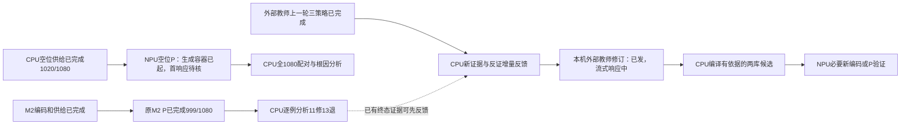

# CPU与NPU异步任务图

本页原位维护；服务占显存不代表有效满载。当前P基线1001/1080，信息不足确认例外0，TEST尚未启动。

三个项目Codex子进程分工：Terra负责空位策略实际P；Sol负责完整P根因分析；Sol增量反馈已完成；其槽位排入教师终态分析后继。两类知识库独立改变、冻结另一库，oracle slot小试保持60条，不重排S→P、不扩TEST。原M2 1080条用4卡1实例691.014秒，已释放；空位P生成容器已启动，首响应待核，不能宣称满载。

CPU准备和来源输入在NPU准入前完成；已知终态立即触发后继，600秒仅用于后台监测。响应复用若需要额外开发，不阻塞已经可用的完整1080推理入口。未交付实现或忽略最新任务约束的子进程退回原owner，主线程不代写实现。
