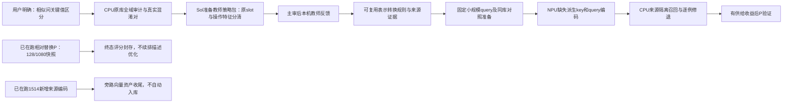

# CPU与NPU异步任务图

当前核心：增强相似问及query中决定意图的关键值/操作关系表示。冻结意图描述，不以扩库代替这个目标。P比较锚1001/1080，稳定新收益尚未锁定。

三个Codex子进程：原Terra收尾相对替换P；原Terra收尾候选向量及必要几何；Sol已按最新指令重新接续教师输入准备。后两条旁路不是新主线教师的前置依赖。旧方向教师包未发送，不重复已完成API。

已有相对替换P真实checkpoint在14:29:54 UTC完成128/1080，4卡1实例，最终指标和ETA未知；新增相似问编码使用独立实例单卡，最终数量待核。CPU分析与NPU异步，任务脱SSH、断点保存、终态触发接续，监测600秒或终态。未宣称所有卡满载。本图为计划与状态，实际执行沿用配置脚本和持久队列。
