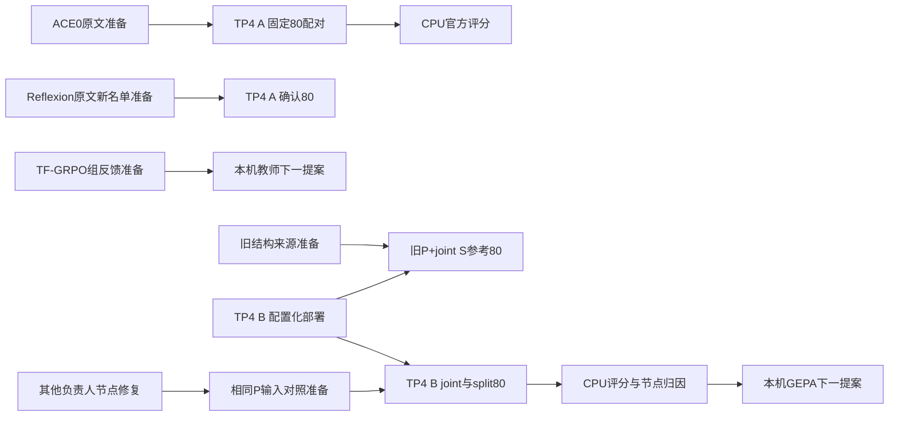

# 两线 TFRL 待执行任务图

Astra已交付16节点研究图，主线程核验依赖无环：10项CPU、4项NPU、2项外部教师任务。目前ACE0与旧joint参考已进入真实持久队列，两个TP4均有在执行请求；后继节点仍在准备，不把图中节点数算作已入队负载。用户已决定两个TP4，不再做布局调研。

ACE0与新名单确认之间只有实例互斥，不以科学评分作为串行前置。B旧结构参考不等待节点修复；新节点对照必须等对应修复和相同P供给。所有新实验使用已有真实TRAIN名单、原文候选与新运行身份，TEST不用于调优。确认名单的历史曝光限制继续披露。

Reflexion旧consumer80的两臂结果已经存在，主线程已核验，无需重发240次生成；其SLU未提升，不晋升。新名单确认是一次预先冻结的诊断延伸，不据确认集调整该候选。六个教师语义审查hold仍保持，不能为了填卡直接上线。

ACE0正常240生成、旧joint参考160生成（各自FIT另计）已启动。旧joint仅一个S，不是独立AA；双S噪声控制没有由此完成。Reflexion后继配置与TF-GRPO反馈包在CPU并行准备。候选generation释放即允许无反馈依赖后继，评分异步。两条线的新队列均需要原生FIT、完整账本、未知请求对账和断点；服务常驻不算负载。机器图见TFRL-Execution-DAG.json。
