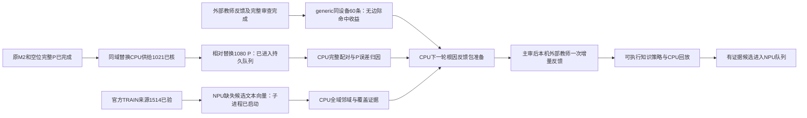

# CPU与NPU异步任务图

P比较锚1001/1080；原M2 999，空位1002但净+1包含同内容波动，未锁定稳定收益。generic slot固定60条相对raw的Top3/5均修0退0。TEST未启动，确认的样本自身信息不足例外0。

实际三个Codex子进程为：Terra完整P执行、Terra相似问候选向量证据、Sol机制反馈包。后两项刚启动，未确认新编码响应；P已进入持久QUEUE_WATCH，尚未确认首响应，不能报告已开始模型生成。现有任务脱离SSH运行；监测600秒或阶段终态，不把600秒当任务间隔。

CPU分析不阻塞独立NPU任务。新增知识编码与P使用不同空闲本项目实例，须服从真实运行互斥，临时释放服务后恢复健康。候选向量不代表自动入库；报告准备不代表API已发；没有真实终态不重发未知请求。

本图是计划与状态记录，不冒充可执行调度器。执行由既有配置化入口及持久队列完成。暂无用户决策缺口，不宣称三实例满载。
