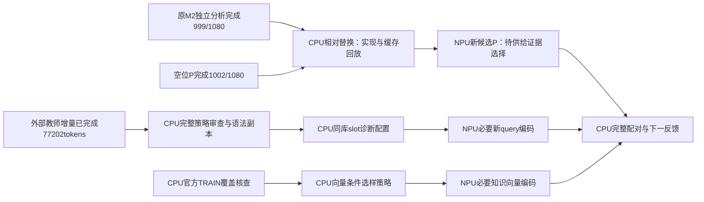

# CPU与NPU异步任务图

P比较锚1001/1080，空位P已完成1002、修4退3；其净+1包含同模型内容重复生成的一次修复，尚无稳定收益。TEST未启动，信息不足确认例外0。

三个Codex子进程：Terra相对替换实现；Sol教师审查；Sol官方TRAIN来源统计。CPU任务并行、准备好才占NPU；未批准配置不自动发模型。已完成空位4卡687.056秒/0.636秒条，终态释放；当前新候选仍在CPU准备，不宣称满载。监测600秒或终态，断链不停止队列，失败保留不盲重发。
