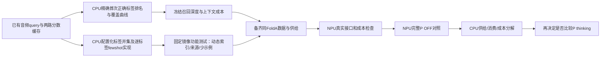

# CPU与NPU异步任务图

当前主线：召回深度覆盖分析 → 双路标签并集 → 每标签K条来源独立few-shot → P Top3。知识改写/新抽取任务及thinking准备均暂停，未发新教师请求。

Sol覆盖分析、Terra供给实现两个Codex子进程已启动，当前没有确认新NPU推理。原relative P已完成1002/1080，1514旁路向量资产完成但不自动入库；两者不作为当前无关前置。任务复用固定镜像和配置入口、脱SSH、checkpoint与真实互斥；终态驱动接续，600秒监测。未宣称所有卡满载。
