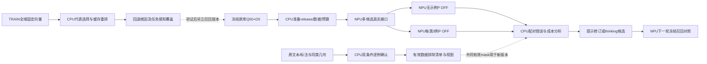

# CPU与NPU异步任务图

当前锁定三项工作：确认缺陷并排除、覆盖驱动相似问代表集、冻结召回优化P消费。三个Codex子进程分别负责；CPU工作不阻塞已经备齐的独立NPU实验。

当前真实状态：缺陷102例审计与3例原文测量完成，0确认排除，四有效视图已生成；两例保留疑点。代表集4451/8554、Q50D5供给1063/1080（原1060，修5退2）；4844版为1061/1080，均未晋升。教师请求约632秒断流，只有思考、无最终content和usage，未知请求不重发。P B持久容器已于15:48:29 UTC启动，A无示例准备并行运行，首个模型响应待核；锚定代表集CPU候选已于15:49:30 UTC运行。优先用已有1080队列首批响应检查接口，避免为额外子集准入继续开发；同管线无示例/3例对照独立准备。

NPU任务入队前CPU备齐依赖，沿用固定镜像、配置化release、真实互斥和checkpoint；脱离SSH，终态事件接续，600秒监测。没有新P首响应证据，不宣称满载。此文件是研究依赖图，不冒充已执行的远端队列。
