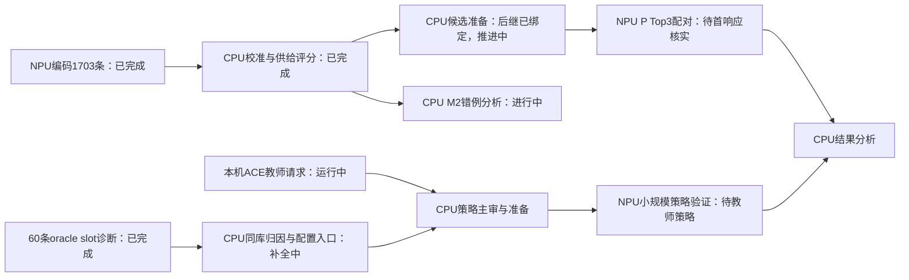

# CPU与NPU异步任务图

本页原位更新于2026-11-08 13:19 UTC。下面区分已执行与待执行，不将服务驻留显存称为有效满载。

M2编码1703/1703，CPU938条全部保留；单卡NPU接续765条145.38秒。FoldA供给1016→1014，修12退14，尚未提升；原预定停止条件未触发，保留P配对验证，不为追结果修改条件。后继依赖完成时触发执行，600秒只用于监测，不应强制任务空等。

两个知识库审计均已完成，8554问句与60描述独立记录。60条oracle slot基线组合Top3为55/60，相比原54/60净+1，但未证明稳定收益，尚未采用教师优化。教师请求本机已启动，只提出机制策略，不直接部署新S节点，不扩大到TEST。

当前三个Codex子进程：M2原owner补齐真实知识库数值验证和P启动；Sol独立分析M2校准/验证/FoldA错例；slot原owner补完整交付和轻量配置入口。未完成工作退回原owner，主线程聚焦归因和研究决策。日常600秒或终态监测；所有新计算复用现有清单、缓存、镜像及来源规则。

TEST冻结，确认的原始信息不足例外仍为0。当前不宣称三实例满载。已有P比较锚Top3=1001/1080，独立Top1=898；具体结果见[当前进度](TFRL-Current-Status-and-Next-Plan)。
