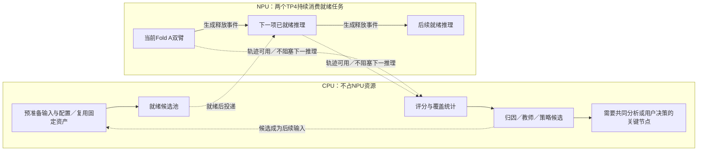

# 新基座与TFRL任务依赖图

## 当前执行规则

**最新覆盖：TFRL准备后置。当前优先负载分析、100%有效回答、同Fold A对齐P→Solver。下述算法项目保留为后续计划，不按旧优先级启动。** 已运行v5/k16和已准备提示对照继续支持系统优化；详细验收见[当前计划](System-Coverage-and-Fold-Alignment.md)。

正常可运行即启动；不以全部恢复边界、所有算法适配或新通用框架作为前置。两个TP4共8卡，NPU维护一条持续队列；CPU维护独立的准备、评分、归因和教师材料队列。CPU任务默认不依赖NPU任务的终态，能够提前做的输入、配置和分析立即执行。NPU释放一个实例后，调度器从已满足科学条件的候选中直接接续，不等待CPU报告。

只有三类依赖可以挡住具体任务：该任务必须使用的上游输入/轨迹尚未产生；不同条件必须先冻结的研究选择；需要用户或主线程共同判读的关键节点。依赖只作用于对应任务，不阻塞另一实例或无关CPU任务。监测600秒或明确终态；运行release不热改，未知请求不盲重发。

本页及同名JSON是研究依赖规格，**不是已经提交的原生运行队列**。实际NPU队列由现有configured-job-queue脚本托管，CPU队列由独立CLI/脚本运行。实际运行状态以[Research-Status](Research-Status.md)和原生任务记录为准。旧页关于v1两臂仍在运行、必须先完成整轮加固再启动的说法已失效。

## 当前准备与执行依赖

|任务|状态|依赖与交付|
|---|---|---|
|Fold A1080 OFF/ON基线|v5两路运行且已有真实响应；15:27:07 UTC complete分别512/1080、278/1080（不等于有效答案）|先就绪先跑；完整评分、覆盖和逐节点耗时|
|回答恢复|共享预算与单次后继已合main，207项相关测试通过|独立候选复验，不阻塞当前两臂|
|构建625/K2|当前A session下两成员真实stage→prepare→register、完整报告及摘要已验收；held未派发|共同基线冻结后采集；OFF只是预备配置，不代表胜出|
|Fold B1080|OFF/ON条件输入均已真实stage→prepare→register，完整报告及11份交付摘要已验收|固定策略确认；不反复在B挑选|
|GEPA Slot/Decision|真实OFF条件seed/contract两节点已交付；待轨迹|准备seed/contract与合法构建轨迹；不等全部算法完成|
|TF-GRPO Slot/Decision|节点经验消费适配已有|K2实际轨迹、反馈和来源reader产出后学习|
|供给k8→k16|两分支各1080条CPU准入完成，两条原生队列已armed，后台等待对应生成释放事件|无需教师；各自对对应k8控制组，取消先挑赢家的前置；就绪后接续|
|知识卡/ACE、Reflexion|ACE启发单卡模板与配方已合main；Reflexion当前PSD闭环待准备|按实际节点证据补最小适配，不冒称已排入队列|

三个CLI分别负责当前运行队列、后继配置准备、首批真实响应与节点终止审计。Fold B执行者完成完整交付后，同一CLI会话自动接续E5 k16注册及具体原生launch/queue配置，已排后台接续，不等人工重新派单。启动执行者独占当前资源租约，CPU执行者不抢占或热改运行树。规划项满足自身依赖后按就绪顺序执行，不等待全部算法适配，不为占卡重复无研究价值的任务。

已锁名单不变：construction625及H1/H2；Fold A1080选型、Fold B1080冻结确认，最终完整TEST13078不参与调优。CPU可以提前准备；实际任务只有满足自身科学依赖和运行条件才派发。

## 六项后续实验及顺序

|优先级|干预|目标与控制|
|---|---|---|
|E1|GEPA Decision提示|只改Decision instruction，检验正确候选已存在时的选取；知识、Slot、P及解码固定|
|E2|GEPA Slot提示|只改Slot instruction，测首答覆盖与实体FP/FN；恢复策略两臂一致|
|E3|TF-GRPO Decision经验|真实同题同policy相对反馈，只注入Decision经验；参考多阶段与融合提案分别登记|
|E4|TF-GRPO Slot经验|同上，目标仅Slot；终局奖励不能直接当节点因果证据|
|E5|P boundary召回8→16|只改召回和供给数量，知识/向量/候选上限固定；无需教师，属于供给控制实验|
|E6|单张槽位卡受限改写|依据原始定义和实际送达的construction失败/反例，仅改说明字段，不增加标签关系|

这是研究优先级，不是强制串行：E5配置可与E1/E2材料同时准备；E3/E4共享合法K2采集产物，各自候选单独评估。ACE/Reflexion未就绪不阻塞前四项。先单轴配对，再组合已确认的正向变化。

## 证据怎样约束实验

历史B1080中，合法P候选719/795包含gold；Decision在gold已存在的582条中错选73条；141条Slot覆盖拒绝中133条已经返回gold候选。这些是旧版本错误机制证据，不能当当前v2错误率或预计可恢复收益。v2已有group_v2与Decision选ID/复制实体，历史协议损失减少应归工程基线变化。

知识审计的402个意图—槽位关联全部有绑定，故不凭空补卡。按“库中存在→实际检索→实际渲染送达→模型输出”定位；正确知识已送达仍出错，才进一步区分表达歧义和模型使用问题。

GEPA当前adapter接受固定三字段v2 pipeline，尚不接新增coverage_recovery字段。若最终选恢复版基线，补这一实际兼容问题即可；不能因为已有模板就声称闭环已就绪。K2 temperature0.7、两seed只用于采集，运行态评估temperature0；重复和同分轨迹保留，无奖励差异不能伪造优势。

## 教师、评分与交付

外部教师从开发机调用，每种算法独立固定模板，动态轨迹由脚本拼接。输入包括原任务/槽位定义、实际节点请求响应和知识供给、父策略/经验、真实奖励及反例；若没有音频，明确教师未听音频。gold仅学习/评分侧可见，不进入actor运行输入。

每项报告全量Intent、官方SLU、Strict、有效回答覆盖、修复/退化样本和成本；节点条件指标只做诊断。学习奖励`0.5×Intent exact + 0.5×单样本exact-slot F1`不等于官方汇总SLU。完成数、秒/条、资源和ETA按实际账本报告，未知不估造。

Sol已交完整六项报告及机器可读材料，主线程复核56份来源摘要全部一致；当前没有新增实验结果。生产代码、规划配置与实际准入状态分别记录。

## 两实例接续顺序

当前Fold A两臂继续执行。每臂终态后，CPU立即做原生评分、全分母覆盖统计及节点失败分类；配对结果支持选型后冻结共同策略。若complete行实际为节点提前终止，应单列，不能当有效答案锁定收益。

共同策略冻结后，两个TP4分别承接既有Fold B1080确认与construction625同策略K2采集；K成员使用不同seed，不能把OFF和ON混成相对奖励组。Fold B只运行已选策略，不用B选型。哪一路空闲且任务自身就绪就先派发，不让CPU评分或教师请求占住NPU资源。

E5 OFF/ON k16供给对照作为不依赖教师和OFF/ON选型的实验，分别与各自k8控制组比较，可在对应实例释放且准备就绪后先执行；GEPA与TF-GRPO从合法construction轨迹异步构造反馈、由本机调用外部教师，各自候选一就绪便安排评估。知识卡实验只改已有卡说明字段，知识定义与来源锁定。已有协议、配置和脚本够用就复用，不以新增通用框架作为任务前置。

k16的两条真实队列已完成准入、plan与后台watch，主线程核对配置/plan摘要及两个存活watcher，状态waiting/pending；其他研究图节点仍不能视为已入队。

## CPU 与 NPU 两条队列

生成完成并seal后释放租约，就可触发下一项；不等待CPU评分或报告。既有`generation-released`事件支持这一点，后继配置正在采用。CPU提前准备所有必要输入；NPU取得资源之后不得重新制作数据集或做整套静态“锁定”。固定数据、知识快照、镜像、release与prepared供给按已有身份复用，未变化不重复全量验证；只在内容变化时更新受影响部分，派发时保留必要的当前运行状态检查。

实施范围如实区分：FlightQueue已有preflight/preprocess在generation租约之前及异步评分；外部launcher仍会复核release，worker仍存在身份扫描。后继执行者优先配置复用已有缓存，针对确有重复的路径最小修正；这些冗余尚未全消除，不能仅凭任务图宣布优化完成。当前v5继续运行，不为新增调度策略停机。

队列兼容修复`25c6386f`已通过82项相关测试，支持当前v5前驱的生成释放身份绑定；真实两臂静态绑定通过，实际事件尚待产生。两条实际k16 queue已使用兼容工具完成plan/watch，主审已确认armed；事件尚未出现，未宣称实际接续成功。派发边界与资产复用细则见[CPU/NPU调度约定](CPU-NPU-Dispatch-Policy.md)。

## 新增节点提示对照

[证据引用根因分析](PSD-Evidence-Reference-Analysis.md)已验收：正确P候选丢失和未供给引用导致整节点终止是不同问题。P-only与Slot-only两候选CPU准备独立启动，各自对原k8 OFF同Fold A1080控制，不混k16、不组合两提示；就绪后进入NPU候选池，尚未准入或派发。这是研究者提示控制，不是TFRL算法收益。
