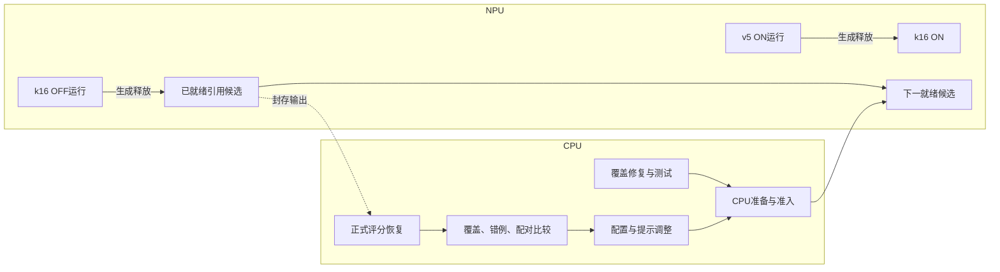

# 系统优化与TFRL任务依赖图

## 当前优先级

先做到原Fold A1080全部样本真实有效回答，再对齐历史P→Solver的Intent85.7407%、官方SLU73.3139%；效率分析与修复并行。TFRL准备和LoRA后置。目标不能用结构合法、测试通过或占卡代替。

本页及同名JSON是研究任务规格，不是原生队列。运行状态以实际container、queue receipt及[Research-Status](Research-Status.md)为准。两个TP4共8卡，最多3路Codex CLI；正常600秒或终态事件观测。

## 当前CPU与NPU任务

|任务|资源|已验证状态及下一步|
|---|---|---|
|v5 Slot OFF|已释放NPU-A|1080生成封存；1038结构完整、23P截断、19引用拒收；CPU评分失败待修复|
|v5 Slot ON|NPU-B|17:12 UTC938/1080；约10.01秒/终态条，旧快照估计余24分钟|
|k16供给对照|NPU-A/B|OFF运行且有真实响应；ON等待本路v5生成释放，不等评分|
|引用隔离候选|NPU-A后继|正式准入和queue plan通过，后台队列等待真实OFF k16生成释放|
|P-only/Slot-only提示|NPU-A后继|已准入，自动绑定器HOLD，覆盖候选优先|
|Perception长度恢复|CPU→就绪池|已合main81d7ea7b；配置化模板、139项相关测试及8项集成测试；stage/prepare/register/admission成功，后继绑定进行中|
|Slot长度恢复|CPU|已知两条非空截断未触发空响应补答；修复已合main c3d1dc17，136相关+3定点测试通过；已安排同部署CLI终态接续完整覆盖候选，未部署|
|官方评分恢复|CPU|根因是运行overlay未在评分重放；独立评分修复已合main，正式CPU恢复容器running，不重跑模型|
|完整配对与历史对齐|CPU|消费真实官方评分与完整1080分母；原failed队列保留，新依赖待评分成功|

引用候选不包含Perception长度修复。待部署候选只有真实准备完成后才进入NPU队列；不把计划当READY，不热改正在运行release。来源/镜像/稳定名单、KB和prepared资产尽量复用。正常推理资源释放后立即接下一项，CPU评分和报告不成为后继依赖。

## 调度关系

CPU先完成必需输入，不在持有NPU资源后做重复锁定和准备。仅真实数据依赖、已冻结的科学选择及必要共同决策阻挡对应任务；不能把全部工程工作串成全局屏障。未知请求不盲重发，原始失败、追加调用和费用全部保留。

## 后续算法计划（当前暂缓）

|干预|优化位置与控制|
|---|---|
|GEPA|分别优化Decision与Slot提示，固定知识、其他节点和解码|
|Training-free GRPO|同题同策略轨迹的相对奖励驱动节点经验；无奖励差异不伪造优势|
|ACE启发知识卡|仅调整已锁卡片的说明，不生成新标签关系|
|Reflexion|基于真实失败反馈形成可验证策略，当前PSD适配尚未完整|

所有方案继续按知识构建、知识消费、上下文/提示三个通道区分。共同系统基线冻结后，原Fold B1080用于独立确认，最终完整TEST13078不调优；construction625及H1/H2名单复用。外部教师在开发机调用，每种算法独立固定模板与脚本采样轨迹，不将gold注入actor。

## 验收口径

分别报告终态/1080、合法完整答案/1080、Intent、官方SLU、Strict、同样本修复与退化；同时给有效答案/秒、卡/实例、ETA及完整调用/token/FIT成本。AI Core与负载在相同推理窗口比较；稀疏采样不冒充持续80%以上。增并发、知识数量、提示与恢复策略分开对照，先保留正向变化再组合。
