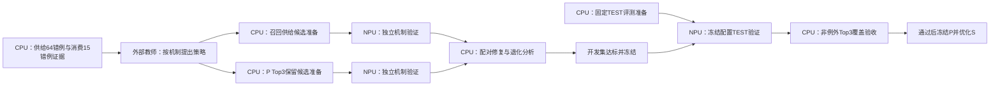

# CPU与NPU异步任务图

本页为任务规划规格，不冒充已派发队列。三个实例、每实例四卡；最多三个Codex子进程。监测按600秒或终态事件，CPU准备完成再占用推理资源。

召回与P消费相互独立准备；共享候选通过开发验收后才组合。当前B Top3/Top1均完成，正确1001/900，Top1无额外恢复；C的LCO单机制对照完成996/1080，相对B修19退24；A配置就绪但候选启动通道待补齐。教师新包和TEST评测入口由CPU准备，当前没有新推理已派发，不能称三实例满载。

已确认信息不足例外为0。保留全量分母，Top1只诊断。具体目标与例外规则见[P三路优化](P-Three-Track-Optimization)，实际结果见[当前进度](TFRL-Current-Status-and-Next-Plan)。历史任务记录可从Git历史追溯。
