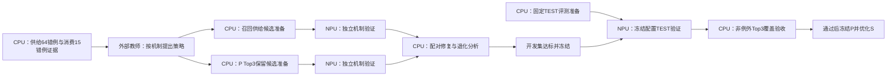

# CPU与NPU异步任务图

本页为任务规划规格，不冒充已派发队列。三个实例、每实例四卡；最多三个Codex子进程。监测按600秒或终态事件，CPU准备完成再占用推理资源。

召回与P消费相互独立准备；共享候选通过开发验收后才组合。B Top3任务Top3为1001、该任务Top1为898；独立Top1任务为900，C LCO为996，三项P教师候选全部完成：C1 1004、C2 1002、TFG T2 1000，各1080完整。消费侧未达到覆盖目标，不按净增数字做策略组合。M1 CPU供给严重退化（1016→780），不启动其NPU实验；M2双向校准编码已在后台执行，供给→P接续由工程子进程补齐；M3暂缓。相似问8554全库审计完成，描述60条独立审计继续，CPU并行准备ACE根因策略反馈包。TEST身份链路部分实现但全流程未验收，待当前召回任务释放资源后接续。当前没有已核新NPU生成任务，M2完成前置并冻结有效候选后通过现有实例接续。

已确认信息不足例外为0。保留全量分母，Top1只诊断。具体目标与例外规则见[P三路优化](P-Three-Track-Optimization)，实际结果见[当前进度](TFRL-Current-Status-and-Next-Plan)。历史任务记录可从Git历史追溯。
