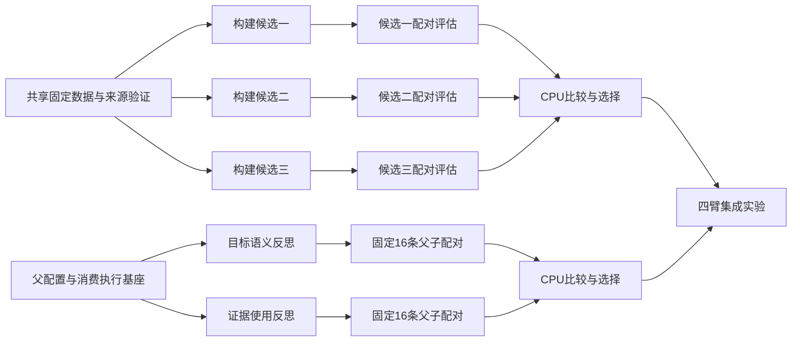

# TFRL 探索任务图与连续队列

知识构建、知识消费分别维护任务图和完整报告，提前准备多个具有明确假设的探索任务。目标是在有效实验和资源允许时，每条研究 lane 保有至少三个可执行后继；这是调度目标，不以无效重复实验凑队列数量。

## 任务与资源

- 全量测试独占四卡实例；构建、消费各分配一个双卡实例。实际交接须核验前一运行终态、请求对账和租约。
- 每个节点记录 `id`、假设、`depends_on`、资源 lane、配置及数据摘要、预算、输出证据、验收条件和失败处理。
- 明确区分 `planned`、`blocked`、`ready`、`queued`、`running` 和终态。配置未绑定、实现未完成或租约未释放的任务不能计为已排队。
- 同一固定真实集合共享使用。反馈、选择及测试边界按实际暴露审计；名单交集排除并不能自动证明剩余数据未参与历史开发。

## 依赖和异步执行

`scripts/npu/card_queue.py` 的 `depends_on` 列出同一队列中必须成功结束的任务 ID。脚本拒绝未知节点和环，按文件顺序选择依赖已满足的节点。失败或禁用前置节点的后继保持待处理；`on_fail=continue` 允许独立分支继续。`on_fail=stop` 用于必须停止整个 lane 的故障。

```json
{"id":"evaluate-candidate","depends_on":["build-candidate"],"on_fail":"continue"}
```

以上为字段示意，实际节点还须提供原队列要求的完整命令、日志和超时配置。命令必须等待真实实验终态并校验证据；只成功启动 detached 容器不能表示实验完成。调度依赖也不能替代候选文件摘要和科学来源校验。

CPU 数据准备、评分、归档与 NPU 推理分别执行。算法依赖 CPU 评分时保留真实依赖，通过其他独立 ready 实验填充 NPU 空档。当前 `depends_on` 只支持队列内依赖；跨队列产物必须由已有准入/来源验证后发布新的可执行配置，不能直接把文件存在当作成功。

## 两条研究分支

构建线并行准备 ACE、training-free GRPO 和 Reflexion 对照，随后分别验证候选知识的实际消费效果；无效候选与冲突处理属于前置功能修复。消费线准备 GEPA 父子比较、Solver 指令以及排序/筛选的独立消融，保持其余条件固定。候选间不得默认有依赖；只有输入产物或选择决策确实依赖时才连边。

构建与消费各自通过小集合验证后，再运行原系统、仅构建、仅消费、组合四臂比较。报告队列 ready/blocked/running 数量、阻塞原因、完成样本、效率和全部成本；未启动的任务不报告 NPU 利用率。

## 验证状态

固定镜像完成 55 项测试及 4 个子测试，覆盖依赖拓扑、失败分支隔离、禁用前置、未知节点/环拒绝及现有恢复/守护功能。记录见 `docs/results/queue-dependency-validation.json`。研究任务图仍在准备；本次脚本验证不表示两个研究队列已经装载或运行。

## 固定镜像容器任务队列

实际基座使用研究目录内的 `scripts/environment/configured_job_queue.py` 驱动固定镜像启动器。新增图模式要求每个 job 都显式列出 `depends_on`（无前置时为 `[]`）；旧配置保持原串行语义。每条资源 lane 同时只运行一个生成任务，两 lane 并行，CPU任务独立运行。

成功依赖在调度时再次核验原容器ID、退出码和持久启动回执；外部依赖继续使用原 `after` 的精确容器身份或已验证的生成释放回执。等待外部产物的节点不阻塞其他独立可运行节点。`on_fail=continue` 允许独立分支接续，默认 `stop`；未知启动结果、来源漂移或回执异常仍中止调度，不能当作失败后自动重发。业务运行锁始终负责资源接续，单纯容器退出不自动释放锁。

配置和脚本版本绑定到队列状态，已启动的队列不可原位改配置；需保留历史并发布明确后继。未就绪的研发节点保存在计划清单，只把完成全部输入绑定的节点装入执行队列。

容器队列及启动/预检联动通过固定镜像88项测试，包含依赖顺序、独立分支接续、断链后不重复启动、外部等待绕行和原有生成释放行为。证据见 `docs/results/configured-queue-dag-validation.json`；测试使用明确Docker替身，不代表研究实验已运行或8卡满载。

失败结算节点可用 `after_terminal` 等待指定节点的已知成功或失败终态；之后的生成节点用 `depends_on` 等待结算成功。它不会把失败实验当作科学成功，也不会把未知请求当作终态。原失败及成本始终保留，结算命令仍须独立核验请求和租约。补充测试后共91项通过，包含失败→结算→后继和未知启动禁止结算的路径。

## 当前装载与补充计划

2026-11-03 10:39 UTC 核验：全量测试、构建 ACE、Reflexion 三个执行容器均运行。资源仍为 4+2+2；容器运行不等于 NPU 满载，两个研究任务的逐组反思也不等于并发推理。当前已启动探索任务为 2 个；尚未核验到多后继执行队列，因此不能把研究图的节点数报成已入队数量。

| 研究线 | 当前执行 | 并行准备的后继 | 进入执行队列前的缺项 |
|---|---|---|---|
| 知识构建 | 固定 51 组 ACE 基线，102 次生成调用预算，2 卡 1 实例 | 完整轨迹证据；完整证据+可执行规则任务；再加入 TRAIN 诊断信息，三条独立候选 | 无损输入折叠验证、全部 51 组上下文准入、固定启动配置、终态交接 |
| 知识消费 | 该 lane 暂运行固定 51 组 Reflexion，51 次生成调用预算，2 卡 1 实例 | 意图/槽位目标反思；证据使用反思，分别接固定 16 条父/子/lock 配对；第三条知识呈现假设待具体化 | 原生 mutation 与配对评分集成测试、来源固定、候选配置、lane 交接 |

构建三分支只依赖共同的数据、实现与自身输入准备，不依赖基线评分完成。每个候选生成结束后，其 CPU 审查和评分与下一个独立候选的生成重叠。消费两个 mutation 分支都从同一已固定父配置出发；每次配对依赖自己的候选，不能把另一分支的结果误作前置。两侧均完成有效小集合对照后，才做构建×消费四臂集成。



图表示科学产物依赖。相同 lane 内的资源互斥和终态对账另由运行队列处理，不能把资源排队误写成科学依赖。失败候选的消费评估被阻塞，但清算成功后允许独立候选继续；请求状态未知时只阻塞相应 lane 的交接。

## 队列补充与验收

- 每条线尽量保有至少三个已准备后继，另留探索假设池。无有效科学问题的重复实验不用于凑负载。
- 同时汇报 planned、blocked、ready、queued、running 数量和阻塞原因；所有配置、来源与启动输入绑定后才叫 ready，执行队列及后台 watcher 接受后才叫 queued。
- 除任务数，汇报可执行队列预计覆盖时长；以同类真实任务的秒/组或秒/条估计，未实测的任务保留未知，不套用全量测试吞吐。
- 生成过程中的 CPU 工作者持续准备后继；结果一产生即触发分析，无需等待所有实验完成。以终态事件或 600 秒检查补充队列，避免模型高频轮询。
- 新假设与优先级先调整计划图；活跃队列配置已被摘要绑定，不原位改写。通过独立后继队列接续，保留已有任务、请求和成本身份。
- 每条线交付完整报告：比较假设、数据暴露边界、配置/代码摘要、终态或断点、精度与 repair/break、分阶段耗时和全部成本。缺少稳定精度收益时如实报告。

## 输入准备的已验证改进

构建开发态将重复的大字段与规范JSON字符串转换为可还原的字典引用；原始来源摘要保留，紧凑基线默认字节不变。首个真实组的证据部分由48,046降至27,866 tokens，未降低16,384输出预算；数字不含系统提示和当前知识，不能代表全部51组或原生FIT已通过。三个后继正在并行准备全51组。主线程固定镜像复验160项通过（9.80秒），覆盖还原一致性、来源绑定、原有ACE/恢复路径和任务对照；没有新增模型调用，也没有精度收益结论。
