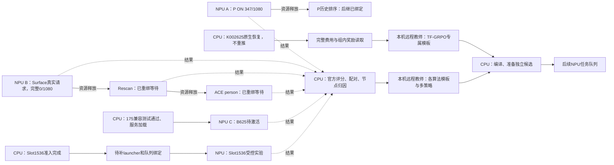

# CPU与NPU异步任务图

更新：2026-11-07 20:30（北京时间）。具体进度见[当前任务与下一计划](TFRL-Current-Status-and-Next-Plan)。实线为资源顺序或准备依赖，虚线为CPU反馈；资源串行不表示策略叠加。

PON、Surface实际运行；175仅服务部署、Slot1536仅CPU准入，不冒充生成。失败Decision63条及旧175P320条保留，恢复不阻塞独立候选。K002625/1887已知请求在CPU恢复链中，不重跑完整数据。

生成释放后下一任务不等评分；数据与配置派发前准备。不依赖前驱科学结果的候选只等资源安全释放，不要求前驱算法成功。当前未证明12卡持续满载或Core持续80%以上。监测600秒或终态事件。

先在Fold A1080选择正向单项，再用既有Fold B1080确认，冻结后完整TEST13078，LoRA后置。供给深度128/模型在途96为独立未启动提案。
