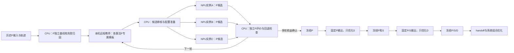

# CPU与NPU异步任务图

2026-11-07 20:46按最新用户顺序更新；完整定义见[逐节点阶段方案](Sequential-Node-Optimization)。当前只优化P，同阶段的候选跨实例并行，后续阶段严格依赖冻结。

这是目标执行图，不是已派发清单。P-only入口与历史P评价正在开发；三实例新任务只承接P阶段。现有正在运行的历史实验保留，尚未启动的旧全链后继已HOLD。CPU分析和NPU采样异步，监测600秒或终态事件。
