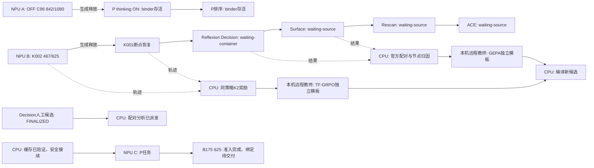

# CPU与NPU异步任务图

更新：2026-11-07 09:06 UTC。图为研究/资源依赖摘要；运行由已存在的配置队列执行，实际进度见[当前任务](TFRL-Current-Status-and-Next-Plan)。

教师四个候选各自继承同一completeON父，不能沿图累加科学改动。所有未知前驱由现有binder读取真实队列状态后绑定。175零请求原因是tiktoken词表缓存未挂载，离线get_encoding0.212秒、create_context2.086秒；正在做旧worker结算与新挂载接续，尚无业务首请求。FIT8/16/32固定镜像39项通过，真实吞吐对照待后继配置，不能宣称提速。

候选先固定Fold A1080比较，冻结后Fold B1080确认，再完整TEST13078、不调优。CPU分析异步，只有必要科学依赖阻挡对应实验。当前尚未实现12卡持续满载。
