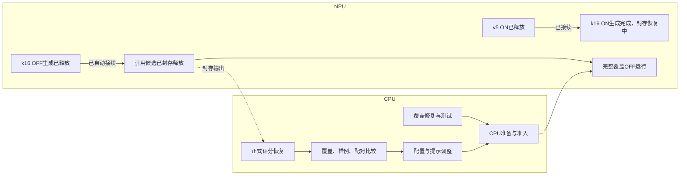

# 系统优化与TFRL任务依赖图

## 当前优先级

先做到原Fold A1080全部样本真实有效回答，再对齐历史P→Solver的Intent85.7407%、官方SLU73.3139%；效率分析与修复并行。TFRL准备和LoRA后置。目标不能用结构合法、测试通过或占卡代替。

本页及同名JSON是研究任务规格，不是原生队列。运行状态以实际container、queue receipt及[Research-Status](Research-Status.md)为准。两个TP4共8卡，最多3路Codex CLI；正常600秒或终态事件观测。

## 当前CPU与NPU任务

|任务|资源|已验证状态及下一步|
|---|---|---|
|v5 Slot OFF|已释放NPU-A|1080生成封存；1038结构完整、23P截断、19引用拒收；官方评分恢复验收成功：Intent81.6667%、SLU64.8754%|
|v5 Slot ON|已释放NPU-B|1080已封存，1037结构完整/43空答；评分及验收完成：Intent82.0370%、SLU71.2196%|
|k16供给对照|NPU-A/B|OFF1080已封存并释放，引用修复后继18:15:33自动启动；OFF正式评分Intent83.06%/SLU64.93%/Strict486已验收；ON1080已落盘、3196请求全部已知，但封存失败阻塞接续，正保全恢复|
|引用隔离候选|已释放NPU-A|1080封存；1052合同合法/28空答（P length26、Slot length2），CPU对账20:47:58成功，attempt已FINALIZED，原评分不变；配对处理中|
|完整覆盖OFF|NPU-A|20:10:48实际容器启动；包含P/Slot长度补问，等待真实完整覆盖结果|
|旧引用提示候选|NPU-A后继|已准入但HOLD，完整覆盖优先；不与新的节点提示候选混称|
|新P-only/Slot-only提示|CPU准备→NPU-B|基共同完整覆盖ON父；8个CPU容器exit0与14项摘要主审通过；准备就绪、自动binder存活，等待真实前驱，未派发；完整覆盖ON→P-only→Slot-only|
|Perception长度恢复|CPU→就绪池|已合main81d7ea7b；配置化模板、139项相关测试及8项集成测试；stage/prepare/register/admission成功；自动绑定器已核实存活，等引用候选真实容器身份|
|Slot长度恢复|CPU|已知两条非空截断未触发空响应补答；修复已合main c3d1dc17，136相关+3定点测试通过；完整候选已准入；已绑定真实引用前驱的生成释放，P-only长度候选HOLD|
|官方评分恢复|CPU|四watcher已部署；引用OFF锁故障已通过原产物对账完成，未重评分；三个后继的锁挂载修复已部署；NPU不等评分|
|生成释放绑定器修复|CPU|已识别CPU评分失败误阻断已释放生成；A已用原生队列接续，修复已合main，92项相关测试通过；P/Slot后继binder部署已主审，completeON原生队列保留|
|答案与节点审计|CPU|完整报告已验收；1038合法，96个P候选遗漏、60个Decision误选；normalizer反事实完整验收，保留原规则；节点提示配置已合main，58条配对回退报告已验收；锁定参考句补证已验收，已纠正日期错例归因|
|完整配对与历史对齐|CPU|消费真实官方评分与完整1080分母；两臂score-ready已验证；原failed队列保留，fresh CPU配对完整验收；SLU+6.34pp，Strict134改善/58退步，覆盖与历史对齐未完成|

CPU评分接续已部署并实际触发；另发现binder在前驱已生成释放但CPU评分失败时提前退出。A完整覆盖已用原有bound queue恢复接续，最小通用修复已合main并部署到两个后继binder，不改运行release。B当前另有封存源码校验故障，不能称8卡持续满载。

引用候选不包含Perception长度修复。待部署候选只有真实准备完成后才进入NPU队列；不把计划当READY，不热改正在运行release。来源/镜像/稳定名单、KB和prepared资产尽量复用。正常推理资源释放后立即接下一项，CPU评分和报告不成为后继依赖。

## 调度关系

CPU先完成必需输入，不在持有NPU资源后做重复锁定和准备。仅真实数据依赖、已冻结的科学选择及必要共同决策阻挡对应任务；不能把全部工程工作串成全局屏障。未知请求不盲重发，原始失败、追加调用和费用全部保留。

## 后续算法计划（当前暂缓）

|干预|优化位置与控制|
|---|---|
|GEPA|分别优化Decision与Slot提示，固定知识、其他节点和解码|
|Training-free GRPO|同题同策略轨迹的相对奖励驱动节点经验；无奖励差异不伪造优势|
|ACE启发知识卡|仅调整已锁卡片的说明，不生成新标签关系|
|Reflexion|基于真实失败反馈形成可验证策略，当前PSD适配尚未完整|

所有方案继续按知识构建、知识消费、上下文/提示三个通道区分。共同系统基线冻结后，原Fold B1080用于独立确认，最终完整TEST13078不调优；construction625及H1/H2名单复用。外部教师在开发机调用，每种算法独立固定模板与脚本采样轨迹，不将gold注入actor。

## 验收口径

分别报告终态/1080、合法完整答案/1080、Intent、官方SLU、Strict、同样本修复与退化；同时给有效答案/秒、卡/实例、ETA及完整调用/token/FIT成本。AI Core与负载在相同推理窗口比较；稀疏采样不冒充持续80%以上。增并发、知识数量、提示与恢复策略分开对照，先保留正向变化再组合。
