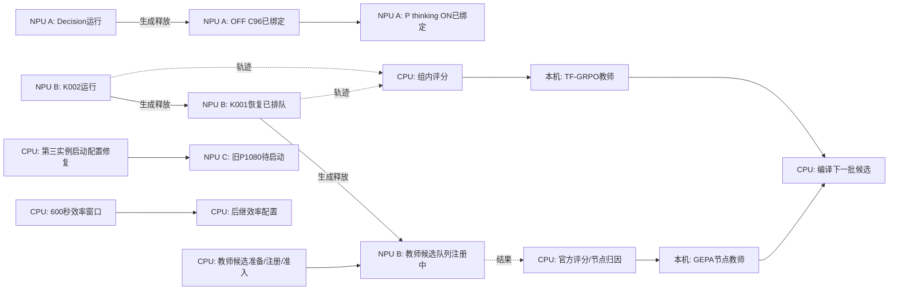

# CPU与NPU异步任务图

更新：2026-11-07 07:10 UTC。研究图不是可执行launcher；当前运行证据和指标见[当前任务](TFRL-Current-Status-and-Next-Plan)。

四个教师策略分别为Reflexion Decision operation/object、Slot spoken-surface、Slot binding-rescan、ACE锁定卡片说明。共同completeON科学父；只改对应节点，不叠加。候选先在固定Fold A1080对比，冻结后Fold B1080确认；完整TEST13078不调优。

CPU准备不得占NPU资源后才开始；评分与生成异步。TF-GRPO的组内奖励是必要科学依赖，其余独立教师候选不等待它。已有固定镜像和配置脚本够用就执行，不扩展泛化加固。12卡持续有效负载是目标，当前第三实例未产出模型请求，不能宣称满载。
